<div align="center">

[](README.md)
[](README.en.md)

# NextThought

**Your next line in the meeting, ready before you need it · native macOS**

It follows the meeting, spots the questions and puts a suggested answer right under your camera. Afterwards it writes up the notes.<br>
Interviews, lab meetings, presentations and defenses, group projects, client calls: each runs its own way.


**[Download the latest version](../../releases/latest)** · [Install](#install) · [Scenes](#nine-scenes) · [Cue island](#cue-island) · [Where your data goes](#where-your-data-goes) · [Changelog](CHANGELOG.md)

</div>

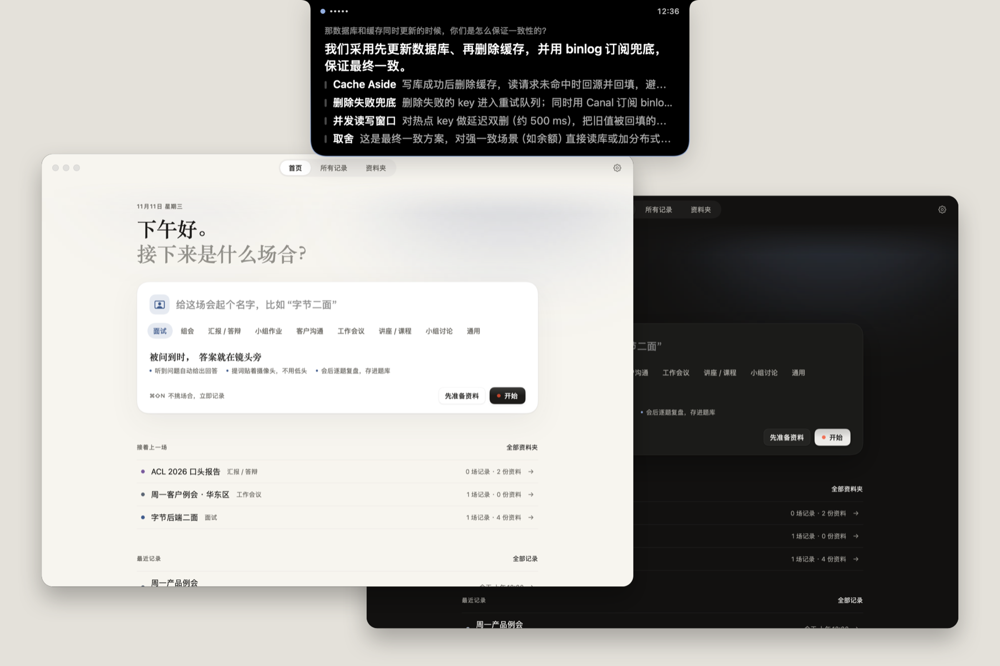

The screenshots show the Chinese interface. The app runs in English too: All settings → General → Language.

## What it does

- **Listens**: transcribes both sides of the meeting on your Mac, offline. The audio itself is not kept by default.
- **Answers**: recognizes a question from the other side and drafts an answer from the materials you gave it. It can also just record, and answer only when you ask.
- **Cues**: the answer appears as a few key points directly below the camera, so you read it without looking away from the lens.
- **Takes notes**: when the meeting ends, the notes are written up the way the scene calls for, and every point links back to what was said. Lessons and recurring questions carry over to the next meeting.

## Cue island

<p align="center">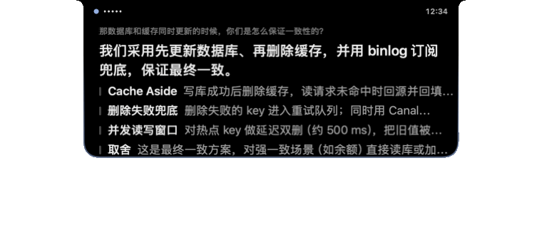</p>

The recording above is rendered frame by frame by the app itself: a question is heard → the answer appears word by word → hovering opens the full text → it folds back into the notch when you have said it → hovering again shows the meeting panel.

The answer unfolds downward from the MacBook's notch, right next to the camera. By default it shows the conclusion and the start of each point, enough to take in at a glance; the full text appears when the pointer rests on it. It never takes keyboard focus, and clicks pass through it.

| Hovering the notch during a meeting | Hovering the notch with no meeting running |
| --- | --- |
| 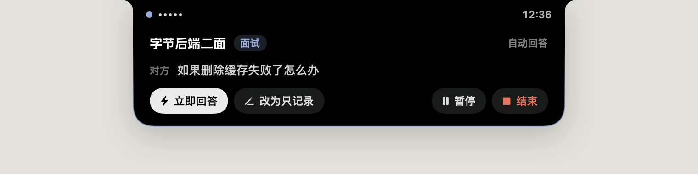 | 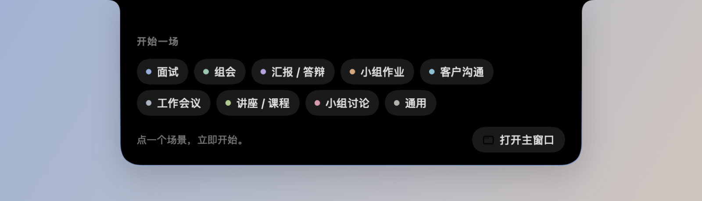 |
| What was just said, Answer now, switch between Auto-answer and Record only, pause, end | Pick a scene and start |

**Keep it open**: if you would rather not move the pointer every time, turn on "Keep the cue island open" (⌘⇧E) and the whole answer stays on screen.

**Dual-screen presenting**: the external display shares your slides, the MacBook holds the presenter view and NextThought. Once the meeting starts the cue island stays open below the camera and the main window steps aside. NextThought follows your slides, showing the points of the current slide and the transition to the next one, and puts the answer first when someone asks a question. Nothing of NextThought appears on the external display.

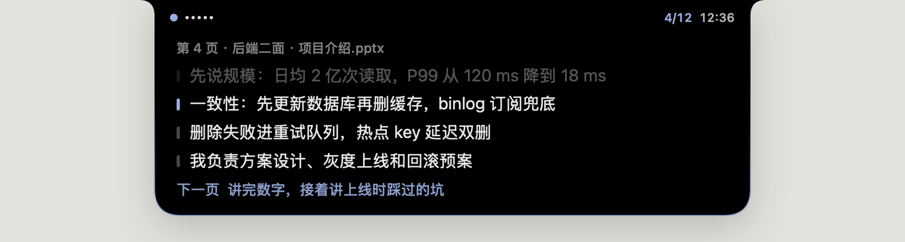

**The live coach** nudges you quietly next to the island: speaking too fast, speaking for too long, one side doing all the talking. It can also use the camera to notice when your eyes leave the lens (landmarks are analyzed on your Mac only; nothing is saved or uploaded).

**Screen sharing**: the cue island stays on the display that has the camera. When you share a single window or another display, it is not in the picture. When you share the whole display it sits on, macOS 15.4 and later no longer let an app exclude itself, so the island folds back into the notch as soon as it detects full-screen sharing in Zoom, Teams, Tencent Meeting, Lark, DingTalk or Webex.

## Home

<p align="center"></p>

Name the meeting, pick a scene, start. Type a title such as "ByteDance second round" or "database course project" and the scene is chosen for you. Each scene has its own color, and the page takes it on.

| Light | Dark |
| --- | --- |
|  | 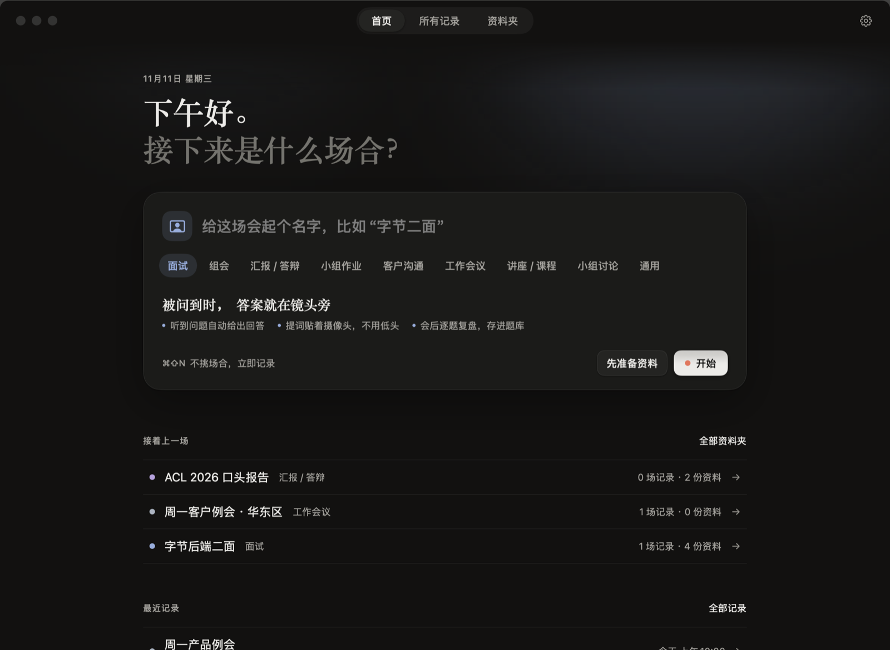 |

## Nine scenes

Before a meeting you make one decision: what kind of occasion it is. How NextThought helps during the meeting, how long the answers are and how the notes are written all follow from the scene. Every one of these can be changed in All settings → Scenes.

| Scene | During the meeting | Notes |
| --- | --- | --- |
| Interview | Auto-answer · brief | A review question by question, saved to the question bank |
| Lab meeting | Record only · detailed | Progress, feedback, next steps |
| Presentation / Defense | Auto-answer · line by line | What the audience asked and how to answer it better |
| Group project | Record only · brief | Plan, who does what, deadlines |
| Client call | Auto-answer · brief | Needs, concerns, what we promised |
| Work meeting | Record only · brief | Decisions, action items, risks |
| Lecture / Class | Record only · detailed | Outline, concepts, open questions |
| Group discussion | Record only · brief | Each side's view, conclusions, who does what |
| General | Record only · brief | Summary, decisions, action items |

Meetings about the same thing belong to one **series**: its materials, the lessons you confirmed and the recurring questions carry over to the next meeting.

## One meeting

| Prepare | In progress | Afterwards |
| --- | --- | --- |
| 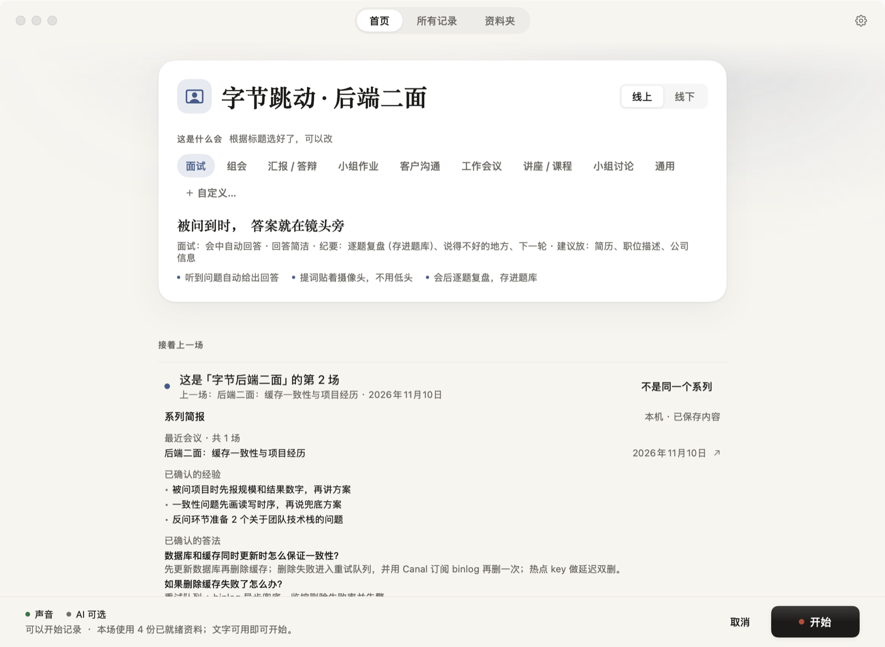 | 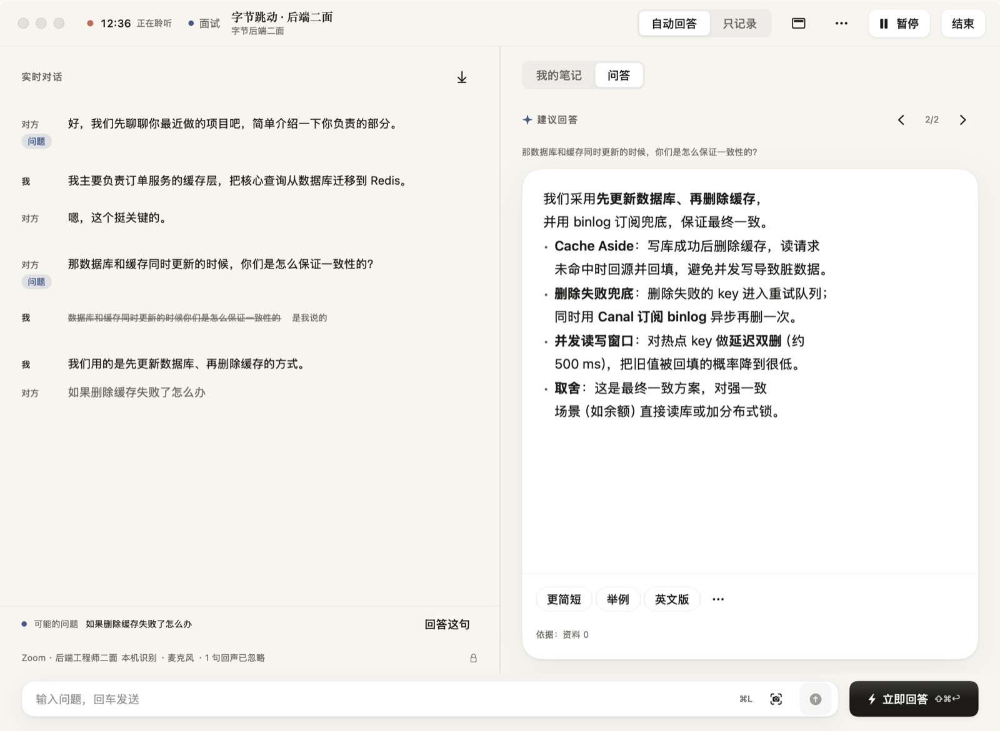 | 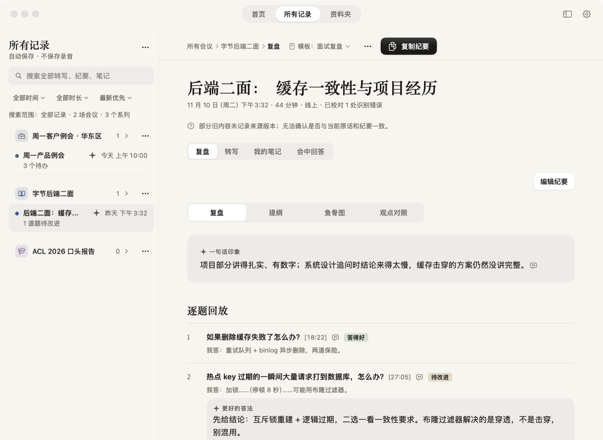 |
| Add a résumé, a script, an agenda or slides, and pick up where the last meeting left off | Live transcript on the left, suggested answers on the right | Notes, transcript and the answers given, with every point linked to what was said |

Materials can be PDF, Word, PowerPoint, Excel, Markdown or images. Online meetings use system audio and the microphone; in-person meetings use the microphone only.

## Settings

| The gear | All settings |
| --- | --- |
| 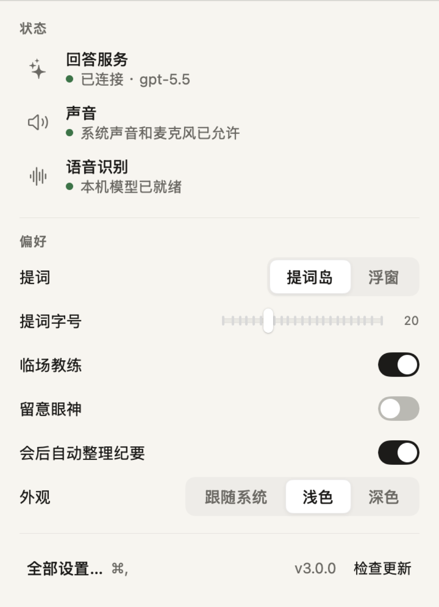 | 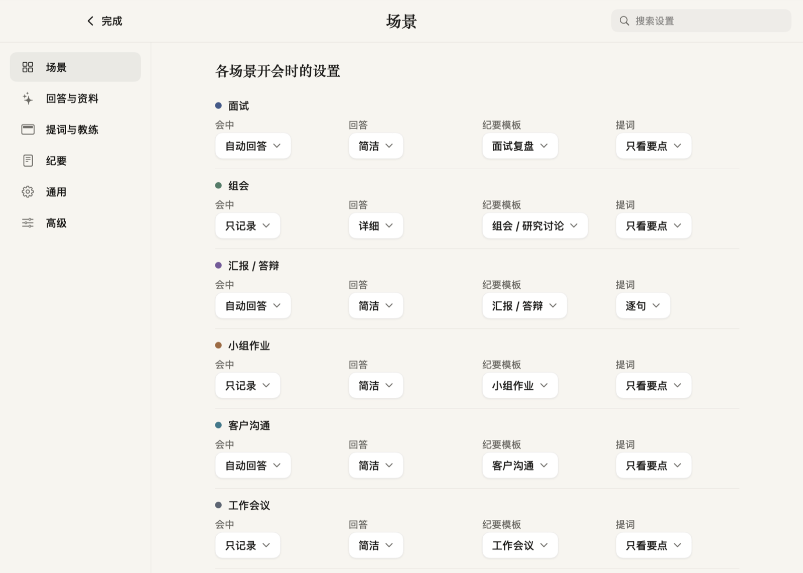 |
| The nine things you change day to day, without opening a window | Six pages in the main window: Scenes, Answers and materials, Cue and coach, Notes, General, Advanced |

## Install

1. Download `NextThought-<version>-macOS-arm64.dmg` from **[Releases](../../releases)** and drag NextThought into Applications.
2. The first time you open it, macOS blocks an app that is not notarized. Click "Open Anyway" at the bottom of **System Settings → Privacy & Security**, or run `xattr -dr com.apple.quarantine /Applications/NextThought.app`.
3. Follow the four-step guide: choose the occasion, allow audio, connect an answer service (optional), start your first meeting.

Requires Apple Silicon and macOS 14 or later. The answer service can be any API key for an OpenAI-compatible endpoint, or a signed-in Codex. Without one the app still records and transcribes; answers and notes need it.

**Updates**: the app checks for new versions, downloads and verifies them in the background, and shows "Restart to update" in the title bar when one is ready. Every version is signed with the same identity, so permissions do not have to be granted again. Building from source, binding a local signing identity and updating from the command line are covered in [Development and releases](docs/DEVELOPMENT.md) (in Chinese).

## Shortcuts

| Shortcut | Action |
| --- | --- |
| ⌘N / ⌘⇧N | New meeting / Record now |
| ⌘⇧Return | Answer now |
| ⌘⇧O | Show or hide the cue |
| ⌘⇧E | Keep the cue island open / back to normal |
| ⌘⇧1 | Shorten answer |
| ⌃⌘← / ⌃⌘→ | Previous / next answer |
| ⌘⇧M / ⌘⇧P | Start or end / pause or resume |
| ⌘⇧\ | Hide all windows; press again to bring them back |
| ⌘, | All settings |

Every shortcut can be viewed and changed in All settings → Cue and coach → Shortcuts.

## Where your data goes

| Data | Where it goes |
| --- | --- |
| Raw audio | Recognized on your Mac and not saved. It is streamed to a provider only if you choose cloud recognition and agree to it |
| Transcript, questions, related passages from your materials, screenshots, skills | Sent to the answer service you chose (your own API or Codex) |
| Web search | When turned on, questions that need current information go to Codex with web access, or the question text is sent to Tavily |
| Imported materials, meeting records, series, backups | All on your Mac in `~/Library/Application Support/NextThought`, without audio |
| Notes after a meeting | By default the transcript and related passages are sent to the answer service to be written up; this can be turned off in All settings → Notes |
| Camera (when watching eye contact) | Frames are reduced to landmarks on your Mac; nothing is saved or uploaded |
| API key | The system keychain |
| Phone companion | Off by default; syncs only the current question, the answer and its sources |
| Update check | Reads this repository's Releases from api.github.com |

Follow the rules of your meeting, course, exam and organization, and get the participants' consent before recording.

## Not yet tested in real use

Watching eye contact, folding away during full-screen sharing (both from 3.0.0) and a complete meeting with real audio have not been verified with a real camera, a real screen share and a real meeting.

## Build from source

Requires Apple Silicon and a Swift 6 toolchain (Xcode or the Command Line Tools):

```sh
swift test --disable-sandbox     # run the tests
./scripts/build-app.sh           # produce dist/NextThought.app and a ZIP
scripts/dev/preview.sh shot home light /tmp/home.png   # render a demo page off screen
```

## Documentation

The documents below are written in Chinese.

- [3.3.0 release notes](docs/releases/v3.3.0.md) · [Changelog](CHANGELOG.md) (full notes for every version)
- [Development and releases](docs/DEVELOPMENT.md): project layout, building, signing, the release process and self-tests
- [Document processing pipeline](docs/DOCUMENT-MARKDOWN-PIPELINE.md) · [Survey of on-device speech recognition models](docs/ASR-MODELS-2026-10.md)
- Bug reports and feature requests: [Issues](../../issues/new/choose)

## Acknowledgements

On-device speech recognition uses the [Sherpa-ONNX](https://github.com/k2-fsa/sherpa-onnx) C API and the Apache-2.0 [X-ASR](https://github.com/Gilgamesh-J/X-ASR) Chinese-English Zipformer models (streaming and offline). Versions, sources and licenses of ONNX Runtime and the models are listed in [`Resources/ThirdPartyNotices.txt`](Resources/ThirdPartyNotices.txt).
