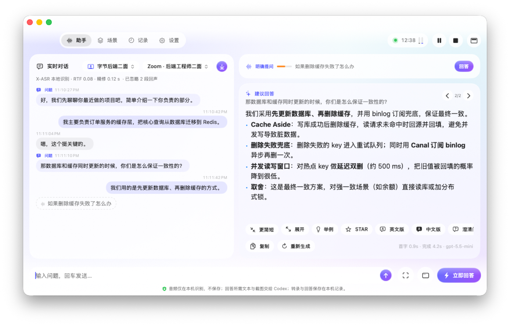
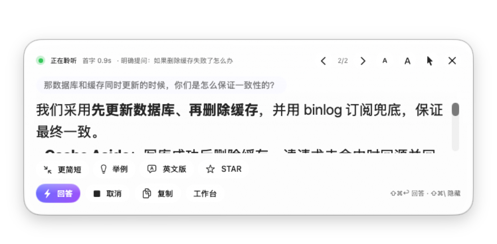
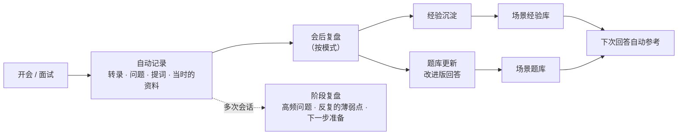

<div align="center">

# InterviewHacker

**面试、学术会议、商务会议、网课的实时 AI 提词助手 · 原生 macOS**

听对方说话 → 实时转写 → 自动判断“这是不是在问我” → 逐字流式给出可以直接说出口的回答<br>
每个场景一套资料，会后自动复盘，经验和题库越用越准


**[⬇️ 下载最新版本](../../releases/latest)** · [界面导览](#界面导览) · [安装](#安装) · [快速上手](#快速上手) · [场景与模式](#场景与模式) · [复盘与自我迭代](#复盘与自我迭代) · [数据与备份](#数据与备份) · [隐私](#数据去向)

<br>

<picture><source media="(prefers-color-scheme: dark)" srcset="docs/screenshots/assistant-dark.png"></picture>

</div>

---

## v1.3 新增

- **场景分区 + 五种模式**：通用 / 面试 / 学术会议 / 商务会议 / 课程，每场面试、每次报告各用一套资料。
- **会后复盘与自我迭代**：经验沉淀进经验库，问到的问题和改进版回答进题库，下次自动参考；支持跨多次会话的阶段复盘。
- **数据不丢**：每天自动备份，更新、导入前也备份；一键导出 / 导入全部设置、场景和记录。
- **识别更准、更快**：X-ASR 中英流式 + 整句精修；问题识别召回 70% → 100%、误触发 3 → 0；扬声器回声自动忽略。
- **自动更新 + 本机签名**：应用内一键“重启以更新”，绑定签名后不用每次重新授权。

完整说明见 [v1.3.0 发布说明](docs/releases/v1.3.0.md) 和 [更新日志](CHANGELOG.md)。

## 界面导览

顶栏四个页面：**助手 · 场景 · 记录 · 设置**。开始 / 暂停 / 停止、计时和双路音量表常驻在右上角，在任何页面都能控制。

### ① 助手：实时对话 + 建议回答（见顶部截图）

- **左侧实时对话**：对方和我分两侧显示，被识别为问题的句子标上“问题”；虚线气泡是对方正在说、还没说完的话。悬停任意一句可以“回答这句”。
- **顶部一行**：当前场景（如“字节后端二面”）和音频来源都可以直接切换；下面一行是识别状态，包括识别引擎、实时率 RTF、整句精修耗时，以及已忽略的回声段数。
- **右侧问题条**：显示识别到的问题类型（明确提问 / 请求 / 追问）和置信度。对方补充了后半句时，会自动改答完整的问题。
- **建议回答**：逐字流式输出，重点加粗；可以左右翻看历史回答。下方一键调整（更简短 / 展开 / 举例 / STAR / 英文版 / 中文版 / 澄清…），右下角显示首字耗时和总耗时。
- **底部输入框**：可以手动输入问题，或截图提问；**立即回答**（⌘⇧Return）会立刻回答最新的问题。

### ② 提词器：放在摄像头下方，看着镜头就能读

<picture><source media="(prefers-color-scheme: dark)" srcset="docs/screenshots/teleprompter-dark.png"></picture>

- 半透明悬浮窗，显示聆听状态、首字耗时、当前问题和回答。可以翻页、调字号，开启鼠标穿透后不挡操作。
- 常用调整和“回答 / 取消 / 复制”都在窗上；⌘⇧\ 一键隐藏全部窗口。

### ③ 场景：每场面试、每次报告各用一套

<picture><source media="(prefers-color-scheme: dark)" srcset="docs/screenshots/materials-dark.png"></picture>

- **左栏**：按模式分组列出所有场景（面试 / 学术会议 / 商务会议…），每个场景显示资料数、题库题数和会话数。点 ＋ 新建，右键可复制或删除。
- **资料与要求**：填写当前模式的专属信息（面试是应聘公司、岗位、面试官 / HR、我的亮点、期望与底线），按分类上传资料（简历、JD、八股、面经…），设置回答要求。
- 右上角可以切换模式、选择回答模板，或用“预测问题”在会前生成可能被问到的问题。

### ④ 经验库与题库：越用越懂你

<picture><source media="(prefers-color-scheme: dark)" srcset="docs/screenshots/workspace-knowledge-dark.png"></picture>

- **经验库**：每次会后复盘提炼出的“下次怎么做更好”。可以置顶（优先交给模型）、删除，也可以手动添加。
- **题库**：对方问过的问题和改进后的回答，记录被问次数，支持搜索。下次遇到同类问题时，优先采用这里准备好的答案。
- 顶部开关控制回答时是否参考这里的内容。

### ⑤ 复盘：看清进步和薄弱点

<picture><source media="(prefers-color-scheme: dark)" srcset="docs/screenshots/workspace-review-dark.png"></picture>

- 顶部统计这个场景累计的会话、问题、经验和题库数量。
- **阶段复盘**：把多次会话放在一起分析，给出总体进展、高频问题（附次数）和下一步准备清单。
- 下方列出这个场景的所有会话，点“查看”跳到记录页。

### ⑥ 记录：每次会话的完整档案

<picture><source media="(prefers-color-scheme: dark)" srcset="docs/screenshots/history-dark.png"></picture>

- 每次会话自动保存，可以按场景筛选。
- 每条记录有四个视图：**摘要**（标题、摘要、完整问题清单含我的回答要点、关键信息、待办、复盘建议）、**问题**、**转录**（可搜索）、**提词**。
- 可以重命名、复制或导出 Markdown、在 Finder 中显示；“已加入场景经验库”表示这次的复盘已经进了经验库和题库。

### ⑦ 设置 → 数据：换模型、换接口、更新都不丢

<picture><source media="(prefers-color-scheme: dark)" srcset="docs/screenshots/settings-data-dark.png"></picture>

- **会话记录与复盘**：可以分别开关记录、会后摘要和自我迭代。
- **导出与导入**：一个 `.ihbackup` 文件包含全部场景、记录和设置，可选是否包含 API Key；导入只合并、不删除现有数据。
- **自动备份**：每天一次，更新前和导入前也会备份；可以从任意一份备份合并恢复。
- 其他分组：常规（外观、系统权限、绑定本机签名）、识别（模型下载与整句精修、回声处理）、回答（引擎与模型）、提词器、更新、快捷键。

<sub>截图由 GitHub Actions 在 macOS 上用演示数据自动生成（`INTERVIEWHACKER_DEMO=1`，见 `.github/workflows/screenshots.yml`），会随你的系统切换深色 / 浅色。</sub>

## 功能

| | |
| --- | --- |
| 🎧 **双路收音** | 分别采集会议窗口的系统声音（对方）和麦克风（我），两路独立识别，抢话也不混；自动识别并忽略扬声器回声，我在说话时等我说完再出回答 |
| ⚡ **两遍本地识别** | 默认离线 X-ASR 中英流式模型边说边出字（带标点、中英混说），每句说完再用离线模型整句精修；也可选 Apple Speech（macOS 26）或云端流式（Soniox / OpenAI / Deepgram）。调研见 [ASR 模型调研](docs/ASR-MODELS-2026-10.md) |
| 🧠 **问题识别** | 区分陈述、未说完、提问、请求（“说一下你对…的理解”“walk me through…”）、追问；去掉口头禅、排除自问自答和“能听到吗”；问句结尾约 0.6 秒内开始回答，对方补充后半句时自动改答完整问题 |
| ✍️ **流式回答** | 常驻 Codex 服务或任意 OpenAI 兼容 API（DeepSeek / 通义 / Kimi / Groq / Ollama…）逐字输出，显示首字耗时 |
| 🗂 **场景分区** | 五种模式，每个场景单独保存结构化信息、分类资料、回答要求、经验库和题库，一键切换 |
| 📄 **资料检索** | PDF 含扫描件 OCR、Word、PPT、Excel、图片在本机解析，按问题检索相关片段并标注 [分类] 文件名与页码 |
| 📝 **会话记录与摘要** | 自动保存完整转录、识别到的问题、提词和当时的资料；结束后生成标题、摘要、**完整问题清单（含我的回答要点）**、待办与复盘，可导出 Markdown |
| 🔁 **复盘与自我迭代** | 按模式复盘，经验和题库自动并入场景，下次回答参考；阶段复盘找出高频问题和反复出现的薄弱点 |
| 💾 **数据与备份** | 所有数据在本机一个文件夹；自动备份；一键导出 / 导入（.ihbackup），也可单独导出某个场景 |
| 🔄 **自动更新** | 定期检查 GitHub Releases，后台下载并校验，点“重启以更新”即可；可绑定本机签名，更新后不再重新授权 |
| 🪄 **一键调整** | 更简短、展开、举例、STAR、英文版、澄清问题、我可以反问；会前“预测可能的问题” |
| 🪟 **提词器** | 半透明悬浮窗，可放在摄像头下方，鼠标穿透，历史翻页，一键隐藏全部窗口 |
| 📱 **手机伴侣** | 扫码即用，手机实时显示回答并可遥控，屏幕共享完全看不到 |
| 📸 **截图提问** | 窗口或区域截图，适合代码题、数学题、幻灯片 |
| ⌨️ **全局快捷键** | 全部可自定义，见[下表](#快捷键) |

## 场景与模式

“场景”页按模式分组管理所有场景。每个场景是一套独立的上下文：例如“字节后端二面”和“阿里一面”各用各的简历版本、JD 和面经，“ACL 口头报告”放论文和讲稿。开始辅助前在助手页顶部切换即可，回答只使用当前场景的内容。

| 模式 | 可以填写的信息 | 资料分类 | 复盘重点 |
| --- | --- | --- | --- |
| **面试** | 应聘公司、岗位、面试官 / HR、我的亮点、期望与底线 | 简历 / 岗位 JD / 公司信息 / HR / 面试官 / 八股 / 面经 / 项目资料 | 逐题评价回答、更好的说法、被追问的薄弱点、下一轮要准备的内容 |
| **学术会议** | 报告题目、会议与场次、核心论点、已知局限、预计会被问的问题 | 论文 / PPT / 幻灯片 / 讲稿 / 补充材料 / 附录 / 相关工作 / 审稿意见 | 听众和主持人的每个问题与回答质量、讲得不清楚的部分、论文或 PPT 要补的内容 |
| **商务会议** | 对方公司 / 参会人、会议目标、我方立场与底线、关键数字 | 公司 / 产品资料 / 对方信息 / 议程 / 报价 / 合同 / 会议纪要 | 决定事项、各方承诺与截止时间、未解决的分歧、谈判表现 |
| **课程** | 课程、学习目标 | 课件 / 笔记 / 作业 / 题目 / 教材 | 知识点、老师强调的重点、布置的任务、还没弄懂的地方 |
| **通用** | 场景说明 | 资料 | 讨论要点、对方关心的问题、可以做得更好的地方 |

<sub>切换模式时，未改动过的回答要求会自动换成新模式的模板。</sub>

## 复盘与自我迭代



- 复盘结果默认自动并入会话所属场景（设置 → 数据 可关闭）；也可以在记录页手动“加入场景经验库”。
- 经验和题目会去重合并，相近的问题（“怎么”和“如何”这类说法差异）只保留一条并更新答案。
- 场景页的“经验库与题库”可以手动添加、编辑、删除；置顶的经验会优先交给模型。

## 数据与备份

- 所有数据都在 `~/Library/Application Support/InterviewHacker`：`Workspaces/`（场景）、`Sessions/`（会话记录）、`Backups/`（自动备份）、`models/`（识别模型）。更新应用、更换识别模型或回答接口都不会改动它们。
- **自动备份**：每天一次，安装更新前、导入前各一次，保留最近 10 份；删除的场景也会在 `Backups/deleted-workspaces` 留一份。
- **导出 / 导入**：设置 → 数据 →“导出全部”生成一个 `.ihbackup` 文件（可选是否包含 API Key）；换电脑或重装后“导入”即可。导入只合并、不删除，同一场景以较新的修改为准。
- 旧版本的回答要求、背景说明、预设和会话记录在首次打开 v1.3 时自动迁移。

## 安装

1. 到 **[Releases](../../releases)** 下载 `InterviewHacker-<版本>-macOS-arm64.dmg`，打开后把 InterviewHacker 拖进“应用程序”。（`main-latest` 是 main 分支的最新自动构建，正式版本见带版本号的 Release。）
2. 第一次打开：应用未经 Apple 公证，macOS 会拦截。打开 **系统设置 → 隐私与安全性**，在页面底部点 **“仍要打开”**。
   也可以在终端执行：`xattr -dr com.apple.quarantine /Applications/InterviewHacker.app`
3. 按提示允许 **屏幕与系统音频录制** 和 **麦克风**。授权后如系统要求重启应用，照做即可。

> 需要 Apple Silicon（M 系列芯片）和 macOS 14 或更新版本。Apple Speech 流式识别需要 macOS 26。

### 更新（不用每次重新授权）

**应用内自动更新（推荐）**：设置 → 更新。应用启动后和每 6 小时检查一次 GitHub Releases，发现新版本就在后台下载并校验 SHA-256 与签名，顶栏出现“重启以更新”，点一下即替换并重新打开。仓库是私有的，需要在同一页填一个只读访问令牌（fine-grained token，只勾选本仓库的 Contents: Read-only），或在终端 `gh auth login` 过。

**绑定本机签名（一次即可）**：设置 → 常规 → 系统权限 → “绑定本机签名”。应用会在本机生成一个只属于这台 Mac 的代码签名证书并重新签名自己；之后自动更新下载的每个新版本都会用同一证书重新签名，macOS 认为它是同一个应用，录屏和麦克风权限一直有效。绑定后需要再授权一次，系统可能请求一次登录密码以信任该证书。

也可以用命令行更新（需要已登录的 [GitHub CLI](https://cli.github.com)）：

```sh
./scripts/install-latest.sh
```

它通过 `gh` 下载最新版、校验 SHA-256、替换 `/Applications/InterviewHacker.app` 并重新打开。这样下载的文件不带浏览器的“来自互联网”标记，**不会再弹“仍要打开”**。

**为什么浏览器下载的版本每次都要重新授权？** macOS 的录屏 / 麦克风权限绑定在应用的**签名身份**上。没有固定证书时，CI 只能临时（ad-hoc）签名，每个版本的签名都不同，系统就把它当成新应用。在自己的 Mac 上运行一次：

```sh
./scripts/setup-release-signing.sh
```

它会把本机的固定签名身份（与 `scripts/build-app.sh` 本地构建共用）保存到仓库的 Actions Secrets，之后发布的每个版本都用同一身份签名，**升级后权限保持不变**。如需完全免除 Gatekeeper 提示，可加入 Apple Developer Program 并配置 Developer ID 与公证（见 [开发文档](docs/DEVELOPMENT.md#签名与公证)）。

## 快速上手

1. **设置 → 回答引擎**
   - 已安装并登录 ChatGPT / Codex 客户端：用默认的“Codex 常驻服务”，选模型，推理强度建议 `low`。
   - 或选“OpenAI 兼容 API”，点“常用”选服务商，填模型 ID 和 API Key（存入钥匙串）。
2. **设置 → 识别**
   - 本地流式（推荐）：首次下载约 270 MB（X-ASR 流式 + 整句精修两个模型，来自 sherpa-onnx 官方发布并校验 SHA-256）；之后离线识别，系统声音和麦克风各用独立识别流。
   - Apple Speech 仅支持所选单一语言；中英混说可用 Zipformer，或在同意上传后选择云端流式 + Soniox。
3. **场景** 页：点 ＋ 按模式新建场景（例如“字节后端二面”），填写模式对应的信息，按分类添加资料，按需修改回答要求。详见[场景与模式](#场景与模式)。
4. **助手** 页确认当前场景，选择会议窗口作为音频来源，点 **开始**。对方提问会自动出回答；随时按 **⌘⇧Return** 立即回答。
5. 按 **⌘⇧O** 打开提词器，在 设置 → 提词器 里选“摄像头下方”。
6. 结束后点 **停止**，记录页会出现这次的摘要和问题清单，复盘自动进入场景的经验库与题库。

### 快捷键

| 快捷键 | 动作 |
| --- | --- |
| ⌘⇧Return | 立即回答（输入框 → 最新问题 → 最近转写） |
| ⌘⇧O | 显示 / 隐藏提词器 |
| ⌘⇧\ | 一键隐藏全部窗口（再按恢复） |
| ⌘⇧K | 提词器鼠标穿透 |
| ⌘⇧1 | 把回答改短 |
| ⌃⌘← / ⌃⌘→ | 上一条 / 下一条回答 |
| ⌘⇧Y | 复制回答 |
| ⌘⇧M / ⌘⇧P | 开始停止 / 暂停恢复 |
| ⌘⇧Esc / ⌘⇧R | 取消 / 重新生成 |
| ⌘⇧A / ⌘⇧S | 窗口截图 / 区域截图 |

### 屏幕共享时怎么看回答

- **共享单个窗口或浏览器标签页**：对方看不到提词器，最推荐。
- **共享整个屏幕**：设置里的“尽力从屏幕共享中排除”对很多软件有效，但 macOS 没有能保证排除录屏的公开接口，macOS 15 起部分整屏共享仍可能拍到。用 **设置 → 共享可见性测试** 自己确认；最稳妥是开 **手机伴侣** 用手机看。

## 数据去向

| 数据 | 去向 |
| --- | --- |
| 原始音频 | 默认只在本机识别，不保存。选择云端识别并勾选同意后，实时上传到你选的服务商 |
| 转录、问题、检索到的资料片段、截图 | 发送给你选的回答引擎（Codex 或你配置的 API） |
| 导入的资料 | 在本机解析，随所属场景保存在本机 |
| API Key | 系统钥匙串 |
| 手机伴侣 | 默认关闭；只同步当前问题和回答，链接含一次性随机配对码，局域网明文 HTTP |
| 会话记录、场景、备份 | 全部在本机 `~/Library/Application Support/InterviewHacker`（不含音频）；可在 设置 → 数据 关闭记录、导出 / 导入或删除 |
| 会后摘要 | 默认开启：会话结束后把这次的转录发给你配置的回答引擎生成摘要与问题清单；可关闭 |
| 更新检查 | 访问 api.github.com 读取本仓库的 Releases；访问令牌保存在钥匙串 |

请遵守会议、课程、考试和面试方的规则，并在录音和转写前取得参与者同意。本软件不宣称“无法被检测”。

## 常见问题

<details>
<summary><b>每次更新都要重新允许录屏 / 麦克风？</b></summary>

macOS 把权限绑定在应用的签名身份上。最简单：在 设置 → 常规 点“绑定本机签名”，再用应用内更新，以后都不用重新授权。维护者也可以运行一次 `./scripts/setup-release-signing.sh`，让发布的版本都用固定签名。详见上方[更新](#更新不用每次重新授权)。
</details>

<details>
<summary><b>点“开始”要等很久？</b></summary>

本机模型首次下载约 270 MB，随后会从 Application Support 加载并在后台预热；识别耗时、RTF 和整句精修耗时显示在对话区顶部。设置 → 识别 里可关闭后台预加载以减少空闲时的内存占用。
</details>

<details>
<summary><b>摘戴耳机、切换 AirPods 后会断吗？</b></summary>

不会。麦克风会自动跟随系统默认输入设备，系统音频中断后自动重连；麦克风暂时不可用时，仍会继续识别对方的声音。
</details>

<details>
<summary><b>手机伴侣提示 “Address already in use”？</b></summary>

新版本会在首选端口被占用时自动换用下一个空闲端口。也可以在 设置 → 手机伴侣 修改首选端口并点“重新生成链接”。手机和 Mac 需要连同一个 Wi‑Fi。
</details>

<details>
<summary><b>共享屏幕时对方会看到提词器吗？</b></summary>

只共享会议窗口或浏览器标签页时看不到。共享整个屏幕时，macOS 没有能保证排除的公开接口，部分软件仍可能拍到——用 设置 → 共享可见性测试 自己确认，或改用手机伴侣。
</details>

<details>
<summary><b>没有 Codex 账号能用吗？</b></summary>

可以。设置 → 回答引擎 选“OpenAI 兼容 API”，填 DeepSeek、通义千问、Kimi、Groq、OpenRouter 的 Key，或本机 Ollama / LM Studio 地址。
</details>

## 文档

- [开发与发布](docs/DEVELOPMENT.md)：项目结构、构建、打包、签名与公证、发布流程、`--self-test` 自检
- [v1.3.0 发布说明](docs/releases/v1.3.0.md)
- [本地语音识别模型调研（2026-10）](docs/ASR-MODELS-2026-10.md)：X-ASR / Qwen3-ASR / FireRedASR2 / SenseVoice / Whisper 对比与实测，回声与抢话处理
- [第二轮改进说明](docs/IMPROVEMENTS-2026-10-14-round2.md)：流式回答、问题识别、云端识别、手机伴侣等设计与验收清单
- [第一轮代码审计](docs/AUDIT-2026-10-14.md) · [历史验证记录](docs/VALIDATION-2026-10-14.md) · [更新日志](CHANGELOG.md)
- 问题反馈与功能建议：[Issues](../../issues/new/choose)

## 从源码构建

需要 Apple Silicon 和 Xcode（Swift 6）：

```sh
swift test --disable-sandbox     # 运行测试
./scripts/build-app.sh           # 生成 dist/InterviewHacker.app 与 ZIP
open dist/InterviewHacker.app
```

详见 [docs/DEVELOPMENT.md](docs/DEVELOPMENT.md)。

## 致谢

本地语音识别使用 [Sherpa-ONNX](https://github.com/k2-fsa/sherpa-onnx) C API 和 Apache-2.0 的 [X-ASR](https://github.com/Gilgamesh-J/X-ASR) 中英 Zipformer 模型（流式 + 离线）；ONNX Runtime 与模型的版本、来源和许可证见 [`Resources/ThirdPartyNotices.txt`](Resources/ThirdPartyNotices.txt)。
