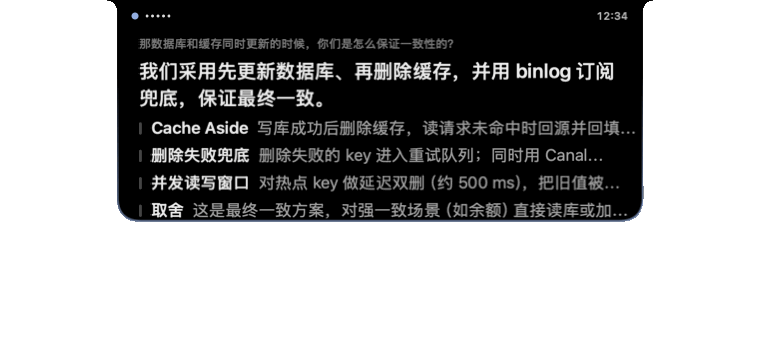
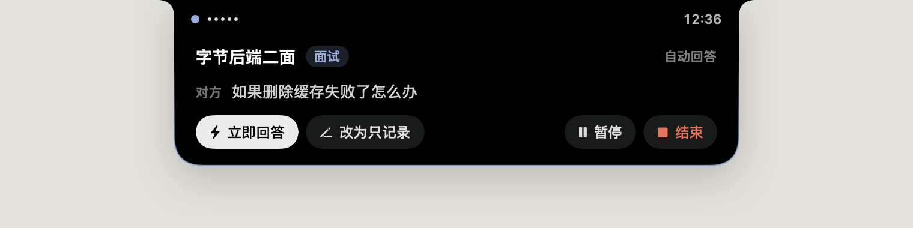
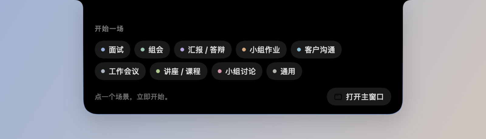
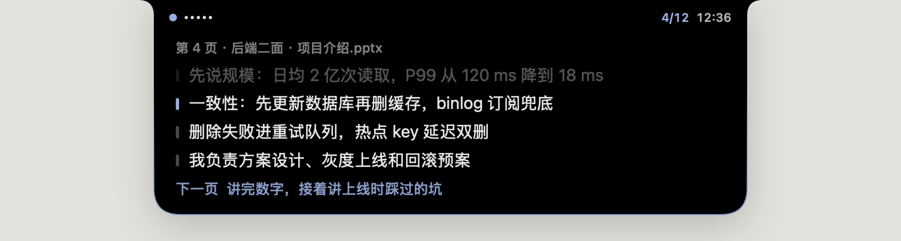
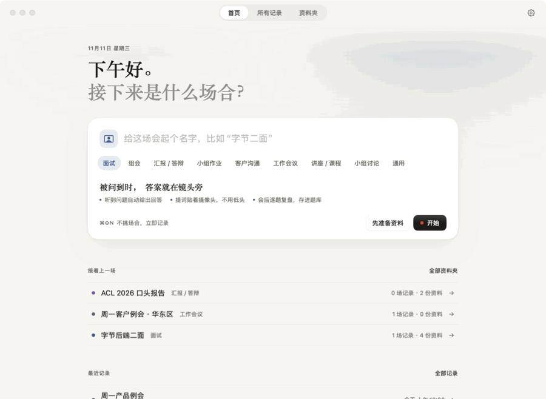
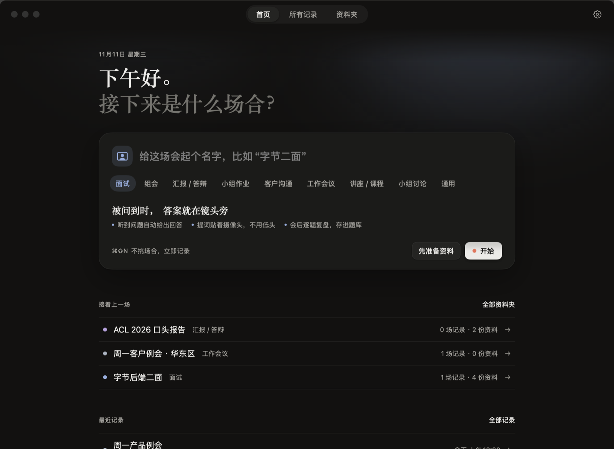
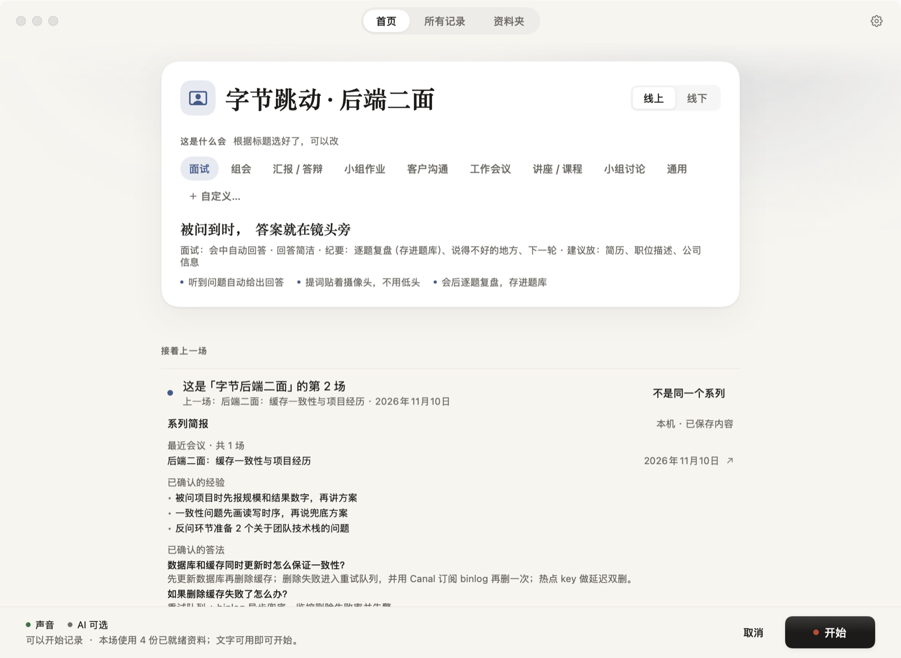
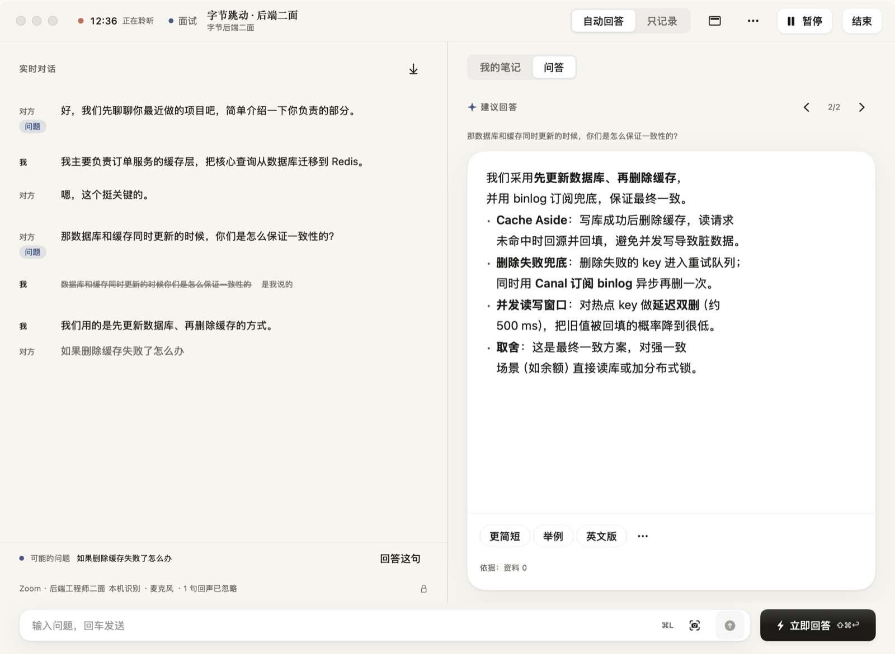

<div align="center">

# NextThought

**会议里的下一句话，提前替你想好 · 原生 macOS**

听懂会议、认出问题、把参考回答放在摄像头下方；会后把纪要整理好。<br>
面试、组会、汇报答辩、小组作业、客户沟通，各有各的开法。


**[下载最新版本](../../releases/latest)** · [安装](#安装) · [场景](#九个场景) · [提词岛](#提词岛) · [数据去向](#数据去向) · [更新日志](CHANGELOG.md)

</div>


## 它做什么

- **听**：在本机离线转写会议里双方的声音，原始音频默认不保存。
- **答**：认出对方的提问，结合你放进去的资料给出参考回答；也可以只记录，需要时再问。
- **提词**：回答以几行要点出现在摄像头正下方，读的时候眼睛不离开镜头。
- **记**：会议结束后按场景整理纪要，要点都能跳回原话；经验和常见问题留给下一场。

## 提词岛

<p align="center"></p>

上面是应用自己逐帧渲染的真实过程：听到问题 → 回答逐字出现 → 鼠标停上去展开全文 → 说完收回刘海 → 再停上去是会议面板。

回答从 MacBook 的刘海向下展开，紧贴摄像头。默认只露结论和每一点的开头，一眼看完；鼠标停上去才显示全文。它不抢键盘焦点，平时点击会穿过它。

| 会议中停在刘海上 | 不开会时停在刘海上 |
| --- | --- |
|  |  |
| 刚听到的话、立即回答、切换自动回答或只记录、暂停、结束 | 点一个场景，直接开始 |

**一直展开**：不想每次把鼠标移上去，就打开“提词岛一直展开”（⌘⇧E），回答一直完整显示。

**双屏演讲**：外接屏共享幻灯片，MacBook 放演讲者视图和 NextThought。会议开始后提词岛一直展开在摄像头下方，主窗口让开；NextThought 跟着你翻页，显示这一页的要点和到下一页的过渡，被提问时先给回答。外接屏上不会出现 NextThought 的窗口。



**临场教练**会在提词岛旁轻声提醒：语速太快、说得太久、发言占比失衡；也可以用摄像头留意眼神有没有离开镜头（只在本机分析特征点，不保存、不上传）。

**屏幕共享**：提词岛只待在摄像头所在的屏幕上。共享某个窗口或另一块屏幕时，它不在画面里；共享它所在的整块屏幕时，macOS 15.4 起系统不再允许应用把自己排除在外，所以它会在识别到 Zoom、Teams、腾讯会议、飞书、钉钉或 Webex 的整屏共享后自动收回刘海。

## 首页

<p align="center"></p>

给会议起个名字，选一个场景，开始。输入“字节二面”“数据库大作业”这样的标题，场景会自己选好；每个场景有自己的颜色，页面跟着它变。

| 浅色 | 深色 |
| --- | --- |
|  |  |

## 九个场景

开会前只做一个决定：这是什么场合。会中怎么帮、回答多长、纪要怎么写，都跟着场景走；每一项都能在“全部设置 → 场景”里改。

| 场景 | 会中 | 纪要 |
| --- | --- | --- |
| 面试 | 自动回答 · 简洁 | 逐题复盘，存进题库 |
| 组会 | 只记录 · 详细 | 进展、意见、下一步 |
| 汇报 / 答辩 | 自动回答 · 逐句提词 | 听众问了什么、怎么答更好 |
| 小组作业 | 只记录 · 简洁 | 方案、分工、截止时间 |
| 客户沟通 | 自动回答 · 简洁 | 需求、顾虑、我们答应的事 |
| 工作会议 | 只记录 · 简洁 | 决定、待办、风险 |
| 讲座 / 课程 | 只记录 · 详细 | 提纲、概念、疑问 |
| 小组讨论 | 只记录 · 简洁 | 各方观点、结论、分工 |
| 通用 | 只记录 · 简洁 | 总结、决定、待办 |

同一件事的多场会议归成一个**系列**：资料、确认过的经验和常见问题会带到下一场。

## 一场会

| 准备 | 进行中 | 会后 |
| --- | --- | --- |
|  |  |  |
| 放进简历、讲稿、议程或课件，接着上一场 | 左边实时转写，右边参考回答 | 纪要、转写、会中回答，要点可回到原话 |

支持 PDF、Word、PPT、Excel、Markdown 和图片资料；线上会议收系统声音和麦克风，线下只用麦克风。

## 设置

| 点齿轮 | 全部设置 |
| --- | --- |
|  |  |
| 日常只需要的九项，不开新窗口 | 主窗口里的六页：场景、回答与资料、提词与教练、纪要、通用、高级 |

## 安装

1. 到 **[Releases](../../releases)** 下载 `NextThought-<版本>-macOS-arm64.dmg`，把 NextThought 拖进“应用程序”。
2. 第一次打开时 macOS 会拦截未公证的应用：在 **系统设置 → 隐私与安全性** 底部点“仍要打开”，或执行 `xattr -dr com.apple.quarantine /Applications/NextThought.app`。
3. 跟着四步引导走：选场合、允许声音、连接回答服务（可跳过）、开始第一场。

需要 Apple Silicon 和 macOS 14 或更新版本。回答服务可以用任意兼容 OpenAI 接口的 API Key，或已登录的 Codex；不连接也能记录和转写，回答与会后纪要需要它。

**更新**：应用会自动检查新版本并在后台下载校验，标题栏出现“重启以更新”时点一下即可。各版本使用同一签名身份，更新后不需要重新授权。从源码自行构建、绑定本机签名和命令行更新见 [开发与发布](docs/DEVELOPMENT.md)。

## 快捷键

| 快捷键 | 动作 |
| --- | --- |
| ⌘N / ⌘⇧N | 新会议 / 立即记录 |
| ⌘⇧Return | 立即回答 |
| ⌘⇧O | 显示或隐藏提词 |
| ⌘⇧E | 提词岛一直展开 / 恢复 |
| ⌘⇧1 | 把回答改短 |
| ⌃⌘← / ⌃⌘→ | 上一条 / 下一条回答 |
| ⌘⇧M / ⌘⇧P | 开始或结束 / 暂停或继续 |
| ⌘⇧\ | 隐藏全部窗口，再按恢复 |
| ⌘, | 全部设置 |

全部快捷键可在“全部设置 → 提词与教练 → 快捷键”里查看和修改。

## 数据去向

| 数据 | 去向 |
| --- | --- |
| 原始音频 | 只在本机识别，不保存。选择云端识别并同意后，才会实时上传到你选的服务商 |
| 转写、问题、相关资料片段、截图、技能 | 发送给你选的回答服务（你配置的 API 或 Codex） |
| 联网搜索 | 开启后，需要最新信息的问题交给 Codex 联网，或把问题文本发到 Tavily |
| 导入的资料、会议记录、系列、备份 | 全部在本机 `~/Library/Application Support/NextThought`，不含音频 |
| 会后纪要 | 默认把本场转写和相关资料片段发给回答服务整理；可在“全部设置 → 纪要”关闭 |
| 摄像头（留意眼神时） | 画面只在本机分析成特征点，不保存、不上传 |
| API Key | 系统钥匙串 |
| 手机伴侣 | 默认关闭；只同步当前问题、回答与来源 |
| 更新检查 | 访问 api.github.com 读取本仓库的 Releases |

请遵守会议、课程、考试和所在组织的规则，并在记录前取得参与者同意。

## 尚未实测

3.0.0 的眼神留意、整屏共享时的自动收回，以及真实音频下的完整一场会，还没有在真实摄像头、真实共享和真实会议中验证过。

## 从源码构建

需要 Apple Silicon 和 Swift 6 工具链（Xcode 或 Command Line Tools）：

```sh
swift test --disable-sandbox     # 运行测试
./scripts/build-app.sh           # 生成 dist/NextThought.app 与 ZIP
scripts/dev/preview.sh shot home light /tmp/home.png   # 离屏渲染演示页面
```

## 文档

- [3.0.0 发布说明](docs/releases/v3.0.0.md) · [更新日志](CHANGELOG.md)（历次版本的完整说明）
- [开发与发布](docs/DEVELOPMENT.md)：项目结构、构建、签名、发布流程和自检
- [资料处理管线](docs/DOCUMENT-MARKDOWN-PIPELINE.md) · [本地语音识别模型调研](docs/ASR-MODELS-2026-10.md)
- 问题反馈与功能建议：[Issues](../../issues/new/choose)

## 致谢

本地语音识别使用 [Sherpa-ONNX](https://github.com/k2-fsa/sherpa-onnx) C API 和 Apache-2.0 的 [X-ASR](https://github.com/Gilgamesh-J/X-ASR) 中英 Zipformer 模型（流式 + 离线）；ONNX Runtime 与模型的版本、来源和许可证见 [`Resources/ThirdPartyNotices.txt`](Resources/ThirdPartyNotices.txt)。
