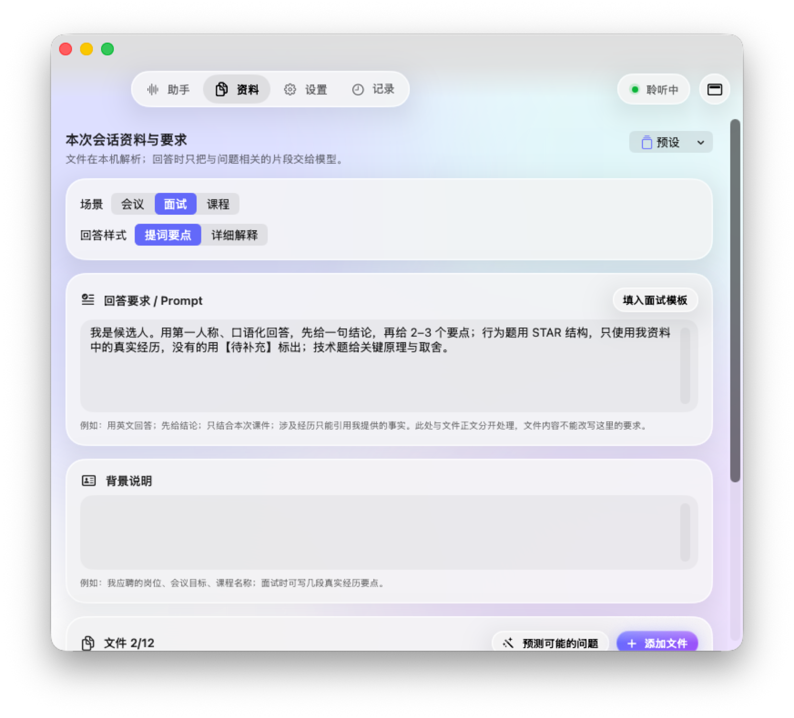
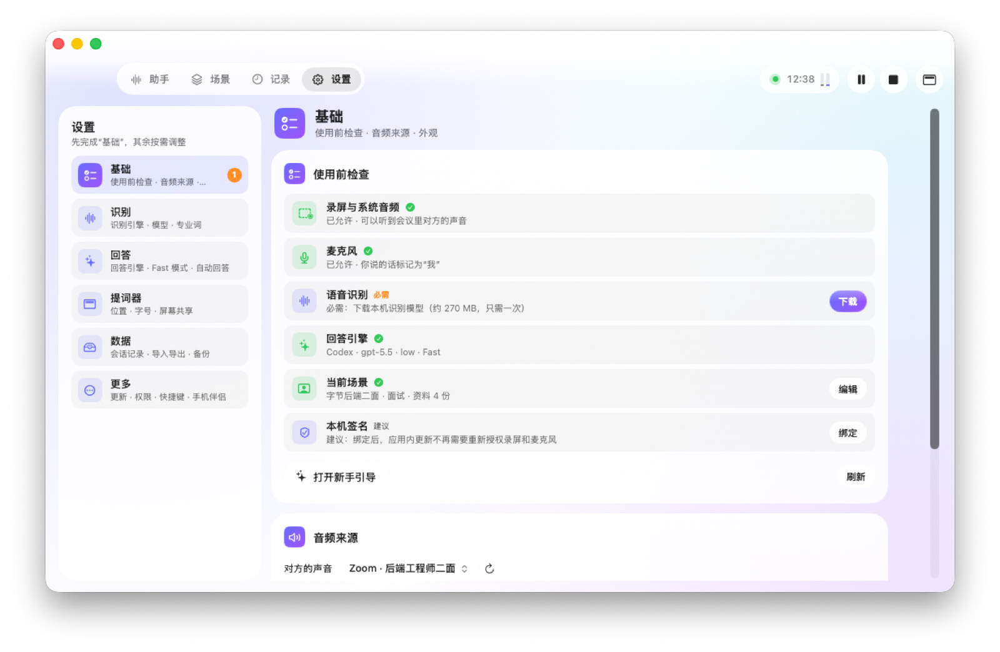
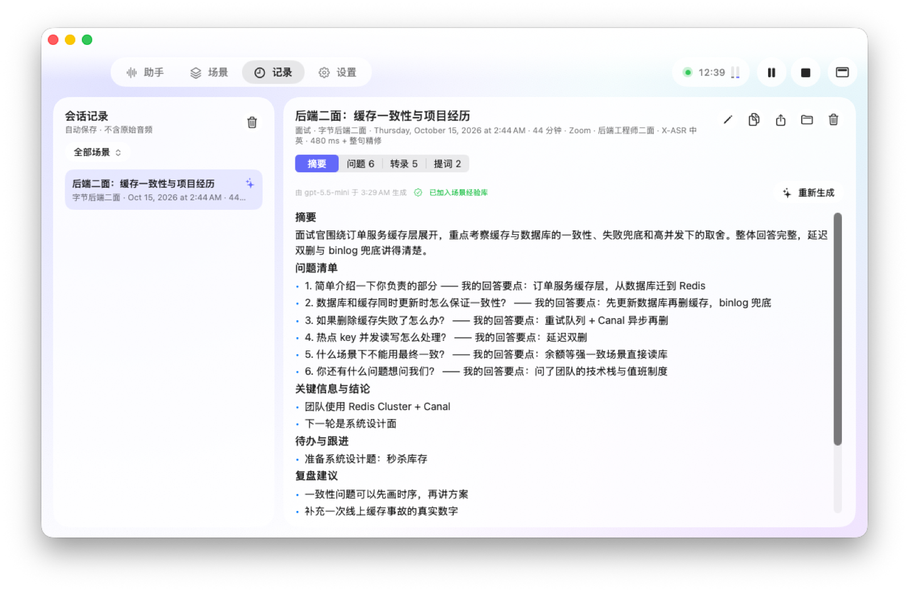

<div align="center">

# InterviewHacker

**会议、面试、网课的实时 AI 提词助手 · 原生 macOS**

听对方说话 → 实时转写 → 自动判断“这是不是在问我” → 逐字流式给出可以直接说出口的回答


**[⬇️ 下载最新版本](../../releases)** · [使用说明](#快速上手) · [隐私](#数据去向) · [开发文档](docs/DEVELOPMENT.md) · [Zipformer 迁移与实测](docs/ZIPFORMER-MIGRATION.md)

<br>

<picture>
  <source media="(prefers-color-scheme: dark)" srcset="docs/screenshots/assistant-dark.png">
  
</picture>

</div>

---

## 截图

| 提词器（可放在摄像头下方，支持鼠标穿透） | 资料与回答要求 |
| --- | --- |
| <picture><source media="(prefers-color-scheme: dark)" srcset="docs/screenshots/teleprompter-dark.png"></picture> | <picture><source media="(prefers-color-scheme: dark)" srcset="docs/screenshots/materials-dark.png"></picture> |
| **设置** | **会话记录** |
| <picture><source media="(prefers-color-scheme: dark)" srcset="docs/screenshots/settings-dark.png"></picture> | <picture><source media="(prefers-color-scheme: dark)" srcset="docs/screenshots/history-dark.png"></picture> |

<sub>截图由 GitHub Actions 在 macOS 26 上用演示数据自动生成（`INTERVIEWHACKER_DEMO=1`，见 `.github/workflows/screenshots.yml`）。</sub>

## 功能

| | |
| --- | --- |
| 🎧 **双路收音** | 分别采集会议窗口的系统声音（对方）和麦克风（我），两路独立识别，抢话也不混；自动识别并忽略扬声器回声 |
| ⚡ **两遍本地识别** | 默认离线 X-ASR 中英流式模型边说边出字（带标点、中英混说），每句说完再用离线模型整句精修；也可选 Apple Speech（macOS 26）或云端流式（Soniox / OpenAI / Deepgram）。调研见 [ASR 模型调研](docs/ASR-MODELS-2026-10.md) |
| 🧠 **问题识别** | 区分陈述、未说完、提问、请求（“说一下你对…的理解”“walk me through…”）、追问；去掉口头禅、排除自问自答和“能听到吗”；问句结尾约 0.6 秒内开始回答，对方补充后半句时自动改答完整问题 |
| 🗂 **会话记录与摘要** | 每次会话自动保存完整转录、识别到的问题、提词和当时的资料要求；结束后由模型生成标题、摘要、**完整问题清单（含我的回答要点）**、待办与复盘建议，可导出 Markdown |
| 🔄 **自动更新** | 定期检查 GitHub Releases，后台下载并校验，点“重启并安装”即可；可绑定本机签名，更新后不再重新授权 |
| ✍️ **流式回答** | 常驻 Codex 服务或任意 OpenAI 兼容 API（DeepSeek / 通义 / Kimi / Groq / Ollama…）逐字输出，显示首字耗时 |
| 📄 **资料与 Prompt** | 导入简历、JD、议程、课件（PDF 含扫描件 OCR、Word、PPT、Excel、图片），按问题检索相关片段并标注页码；场景模板与预设 |
| 🪄 **一键调整** | 更简短、展开、举例、STAR、英文版、澄清问题、我可以反问；会前“预测可能的问题” |
| 🪟 **提词器** | 半透明悬浮窗，可放在摄像头下方，鼠标穿透，历史翻页，一键隐藏全部窗口 |
| 📱 **手机伴侣** | 扫码即用，手机实时显示回答并可遥控，屏幕共享完全看不到 |
| 📸 **截图提问** | 窗口或区域截图，适合代码题、数学题、幻灯片 |
| ⌨️ **全局快捷键** | 全部可自定义，见下表 |

## 安装

1. 到 **[Releases](../../releases)** 下载 `InterviewHacker-<版本>-macOS-arm64.dmg`，打开后把 InterviewHacker 拖进“应用程序”。（`main-latest` 是 main 分支的最新自动构建，正式版本见带版本号的 Release。）
2. 第一次打开：应用未经 Apple 公证，macOS 会拦截。打开 **系统设置 → 隐私与安全性**，在页面底部点 **“仍要打开”**。
   也可以在终端执行：`xattr -dr com.apple.quarantine /Applications/InterviewHacker.app`
3. 按提示允许 **屏幕与系统音频录制** 和 **麦克风**。授权后如系统要求重启应用，照做即可。

> 需要 Apple Silicon（M 系列芯片）和 macOS 14 或更新版本。Apple Speech 流式识别需要 macOS 26。

### 更新（不用每次重新授权）

**应用内自动更新（推荐）**：设置 → 更新。应用启动后和每 6 小时检查一次 GitHub Releases，发现新版本就在后台下载并校验 SHA-256 与签名，顶栏出现“重启以更新”，点一下即替换并重新打开。仓库是私有的，需要在同一页填一个只读访问令牌（fine-grained token，只勾选本仓库的 Contents: Read-only），或在终端 `gh auth login` 过。

**绑定本机签名（一次即可）**：设置 → 常规 → 系统权限 → “绑定本机签名”。应用会在本机生成一个只属于这台 Mac 的代码签名证书并重新签名自己；之后自动更新下载的每个新版本都会用同一证书重新签名，macOS 认为它是同一个应用，录屏和麦克风权限一直有效。绑定后需要再授权一次，系统可能请求一次登录密码以信任该证书。

也可以用命令行更新（需要已登录的 [GitHub CLI](https://cli.github.com)）：

```sh
./scripts/install-latest.sh
```

它通过 `gh` 下载最新版、校验 SHA-256、替换 `/Applications/InterviewHacker.app` 并重新打开。这样下载的文件不带浏览器的“来自互联网”标记，**不会再弹“仍要打开”**。

**为什么浏览器下载的版本每次都要重新授权？** macOS 的录屏 / 麦克风权限绑定在应用的**签名身份**上。没有固定证书时，CI 只能临时（ad-hoc）签名，每个版本的签名都不同，系统就把它当成新应用。在自己的 Mac 上运行一次：

```sh
./scripts/setup-release-signing.sh
```

它会把本机的固定签名身份（与 `scripts/build-app.sh` 本地构建共用）保存到仓库的 Actions Secrets，之后发布的每个版本都用同一身份签名，**升级后权限保持不变**。如需完全免除 Gatekeeper 提示，可加入 Apple Developer Program 并配置 Developer ID 与公证（见 [开发文档](docs/DEVELOPMENT.md#签名与公证)）。

## 快速上手

1. **设置 → 回答引擎**
   - 已安装并登录 ChatGPT / Codex 客户端：用默认的“Codex 常驻服务”，选模型，推理强度建议 `low`。
   - 或选“OpenAI 兼容 API”，点“常用”选服务商，填模型 ID 和 API Key（存入钥匙串）。
2. **设置 → 识别**
   - 本地流式（推荐）：首次下载约 270 MB（X-ASR 流式 + 整句精修两个模型，来自 sherpa-onnx 官方发布并校验 SHA-256）；之后离线识别，系统声音和麦克风各用独立识别流。
   - Apple Speech 仅支持所选单一语言；中英混说可用 Zipformer，或在同意上传后选择云端流式 + Soniox。
3. **资料** 页：拖入相关文件，选场景（面试 / 会议 / 课程），点“填入模板”后按需修改回答要求；可保存为预设。
4. **助手** 页选择会议窗口作为音频来源，点 **开始辅助**。对方提问会自动出回答；随时按 **⌘⇧Return** 立即回答。
5. 按 **⌘⇧O** 打开提词器，在 设置 → 提词器 里选“摄像头下方”。

### 快捷键

| 快捷键 | 动作 |
| --- | --- |
| ⌘⇧Return | 立即回答（输入框 → 最新问题 → 最近转写） |
| ⌘⇧O | 显示 / 隐藏提词器 |
| ⌘⇧\ | 一键隐藏全部窗口（再按恢复） |
| ⌘⇧K | 提词器鼠标穿透 |
| ⌘⇧1 | 把回答改短 |
| ⌃⌘← / ⌃⌘→ | 上一条 / 下一条回答 |
| ⌘⇧Y | 复制回答 |
| ⌘⇧M / ⌘⇧P | 开始停止 / 暂停恢复 |
| ⌘⇧Esc / ⌘⇧R | 取消 / 重新生成 |
| ⌘⇧A / ⌘⇧S | 窗口截图 / 区域截图 |

### 屏幕共享时怎么看回答

- **共享单个窗口或浏览器标签页**：对方看不到提词器，最推荐。
- **共享整个屏幕**：设置里的“尽力从屏幕共享中排除”对很多软件有效，但 macOS 没有能保证排除录屏的公开接口，macOS 15 起部分整屏共享仍可能拍到。用 **设置 → 共享可见性测试** 自己确认；最稳妥是开 **手机伴侣** 用手机看。

## 数据去向

| 数据 | 去向 |
| --- | --- |
| 原始音频 | 默认只在本机识别，不保存。选择云端识别并勾选同意后，实时上传到你选的服务商 |
| 转录、问题、检索到的资料片段、截图 | 发送给你选的回答引擎（Codex 或你配置的 API） |
| 导入的文件 | 在本机解析；只在保存预设时写入本机 Application Support |
| API Key | 系统钥匙串 |
| 手机伴侣 | 默认关闭；只同步当前问题和回答，链接含一次性随机配对码，局域网明文 HTTP |
| 会话记录 | 默认保存在本机（`~/Library/Application Support/InterviewHacker/Sessions`，不含音频），可在 设置 → 记录 关闭、导出 Markdown 或删除 |
| 会后摘要 | 默认开启：会话结束后把这次的转录发给你配置的回答引擎生成摘要与问题清单；可关闭 |
| 更新检查 | 访问 api.github.com 读取本仓库的 Releases；访问令牌保存在钥匙串 |

请遵守会议、课程、考试和面试方的规则，并在录音和转写前取得参与者同意。本软件不宣称“无法被检测”。

## 常见问题

<details>
<summary><b>每次更新都要重新允许录屏 / 麦克风？</b></summary>

macOS 把权限绑定在应用的签名身份上。最简单：在 设置 → 常规 点“绑定本机签名”，再用应用内更新，以后都不用重新授权。维护者也可以运行一次 `./scripts/setup-release-signing.sh`，让发布的版本都用固定签名。详见上方[更新](#更新不用每次重新授权)。
</details>

<details>
<summary><b>点“开始辅助”要等很久？</b></summary>

本机模型首次下载约 270 MB，随后会从 Application Support 加载并在后台预热；识别耗时、RTF 和整句精修耗时显示在对话区顶部。设置 → 识别 里可关闭后台预加载以减少空闲时的内存占用。
</details>

<details>
<summary><b>摘戴耳机、切换 AirPods 后会断吗？</b></summary>

不会。麦克风会自动跟随系统默认输入设备，系统音频中断后自动重连；麦克风暂时不可用时，仍会继续识别对方的声音。
</details>

<details>
<summary><b>手机伴侣提示 “Address already in use”？</b></summary>

新版本会在首选端口被占用时自动换用下一个空闲端口。也可以在 设置 → 手机伴侣 修改首选端口并点“重新生成链接”。手机和 Mac 需要连同一个 Wi‑Fi。
</details>

<details>
<summary><b>共享屏幕时对方会看到提词器吗？</b></summary>

只共享会议窗口或浏览器标签页时看不到。共享整个屏幕时，macOS 没有能保证排除的公开接口，部分软件仍可能拍到——用 设置 → 共享可见性测试 自己确认，或改用手机伴侣。
</details>

<details>
<summary><b>没有 Codex 账号能用吗？</b></summary>

可以。设置 → 回答引擎 选“OpenAI 兼容 API”，填 DeepSeek、通义千问、Kimi、Groq、OpenRouter 的 Key，或本机 Ollama / LM Studio 地址。
</details>

## 文档

- [开发与发布](docs/DEVELOPMENT.md)：项目结构、构建、打包、签名与公证、发布流程
- [本地语音识别模型调研（2026-10）](docs/ASR-MODELS-2026-10.md)：X-ASR / Qwen3-ASR / FireRedASR2 / SenseVoice / Whisper 对比与实测，回声与抢话处理
- [第二轮改进说明](docs/IMPROVEMENTS-2026-10-14-round2.md)：流式回答、问题识别、云端识别、手机伴侣等设计与验收清单
- [第一轮代码审计](docs/AUDIT-2026-10-14.md) · [历史验证记录](docs/VALIDATION-2026-10-14.md) · [更新日志](CHANGELOG.md)
- 问题反馈与功能建议：[Issues](../../issues/new/choose)

## 从源码构建

需要 Apple Silicon 和 Xcode（Swift 6）：

```sh
swift test --disable-sandbox     # 运行测试
./scripts/build-app.sh           # 生成 dist/InterviewHacker.app 与 ZIP
open dist/InterviewHacker.app
```

详见 [docs/DEVELOPMENT.md](docs/DEVELOPMENT.md)。

## 致谢

本地语音识别使用 [Sherpa-ONNX](https://github.com/k2-fsa/sherpa-onnx) C API 和 Apache-2.0 的 [X-ASR](https://github.com/Gilgamesh-J/X-ASR) 中英 Zipformer 模型（流式 + 离线）；ONNX Runtime 与模型的版本、来源和许可证见 [`Resources/ThirdPartyNotices.txt`](Resources/ThirdPartyNotices.txt)。
