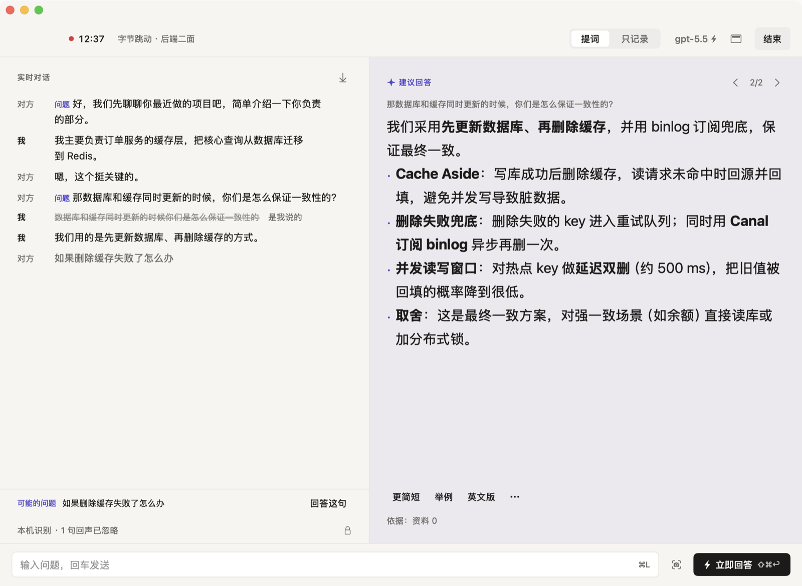
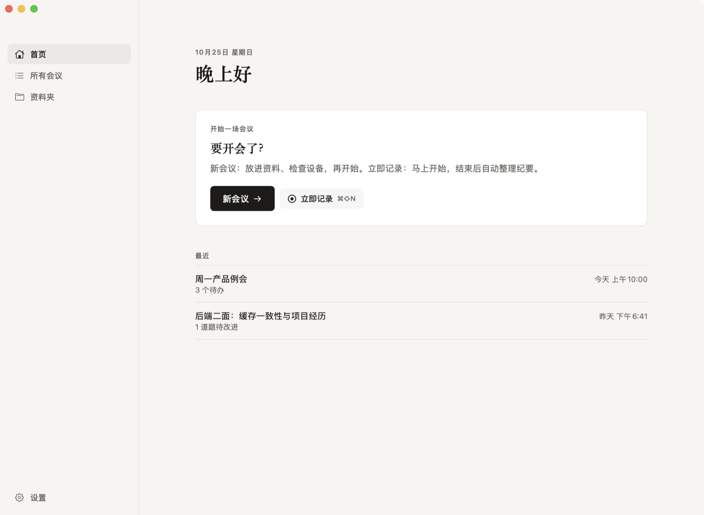
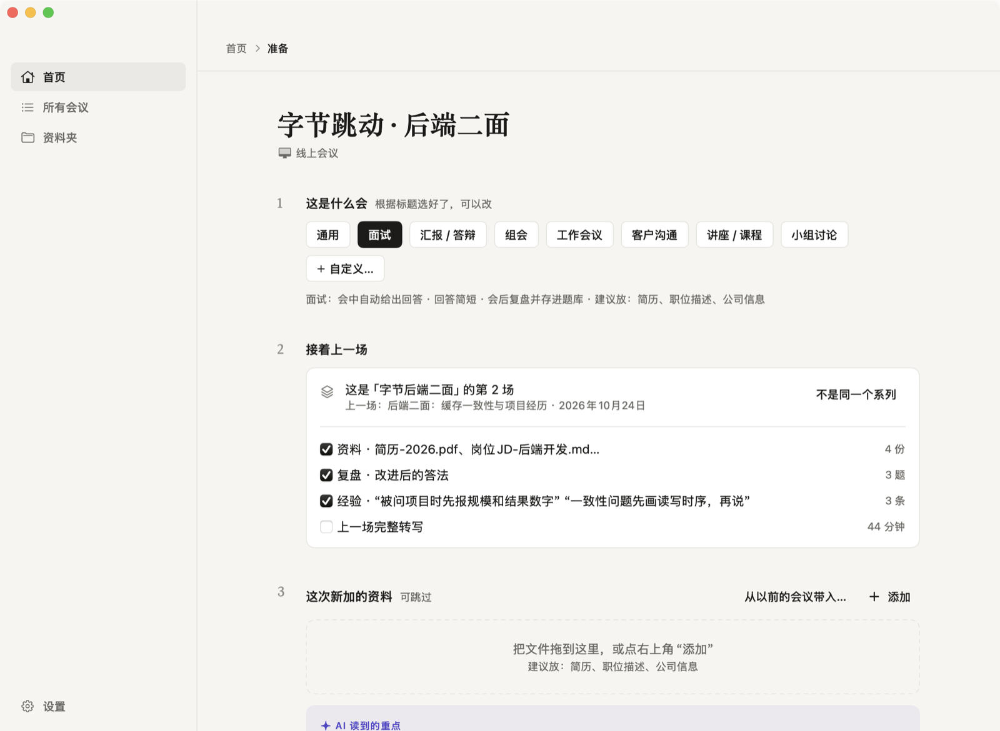
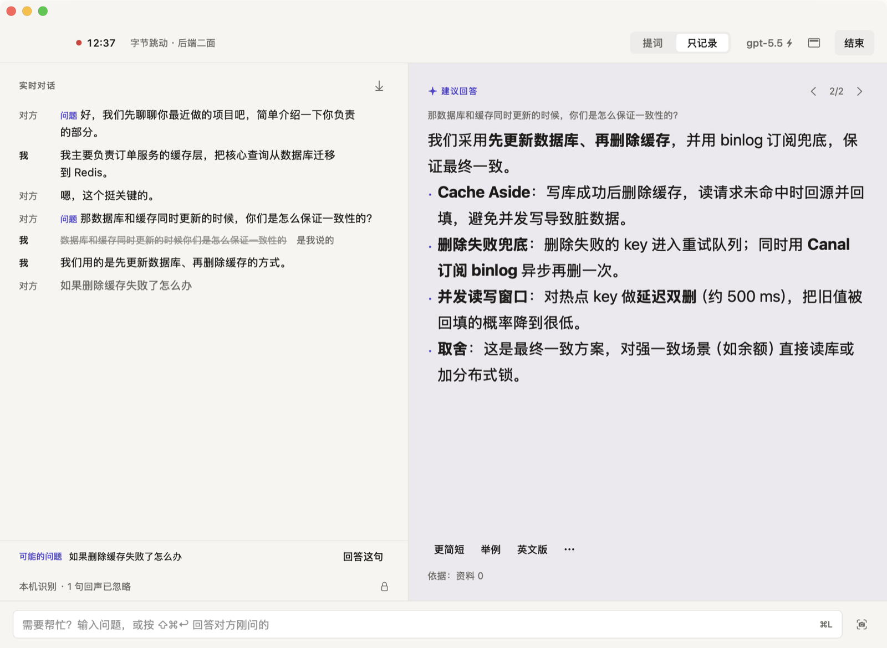
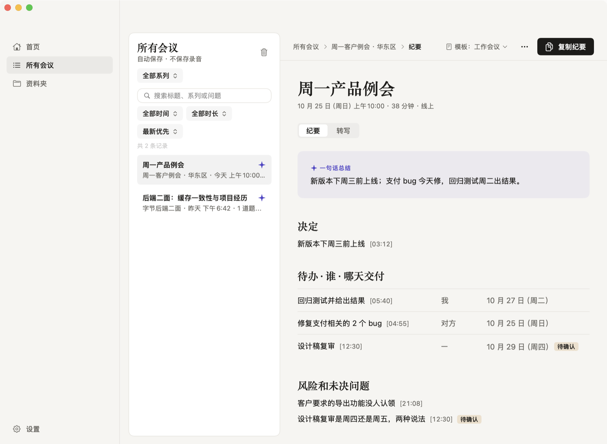
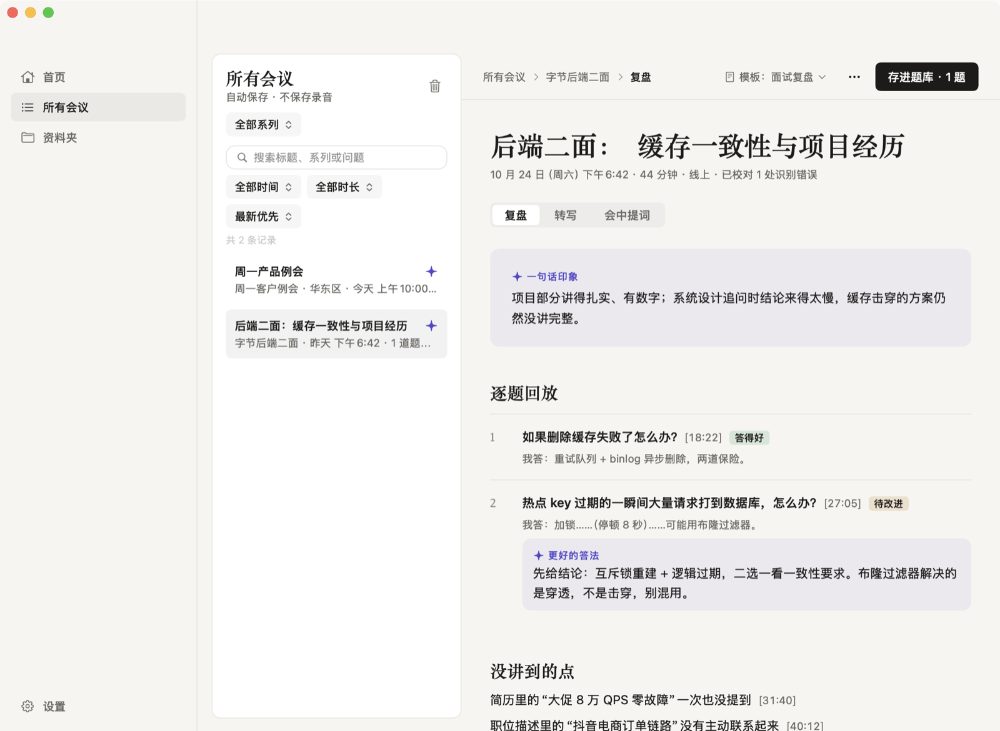
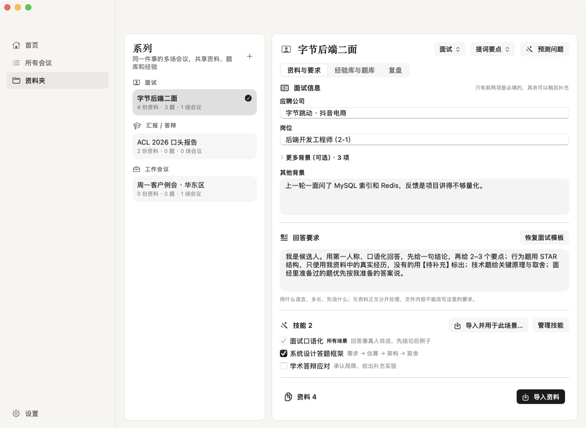
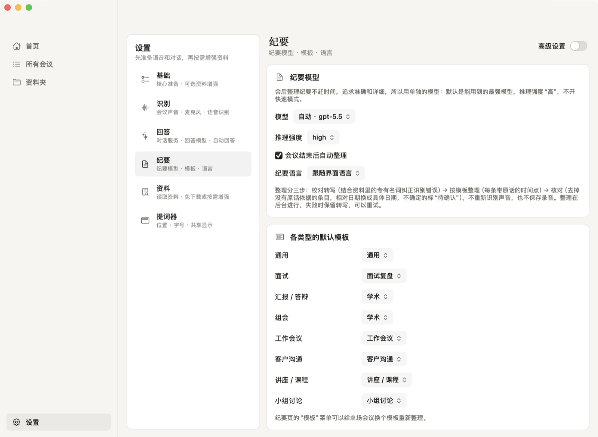
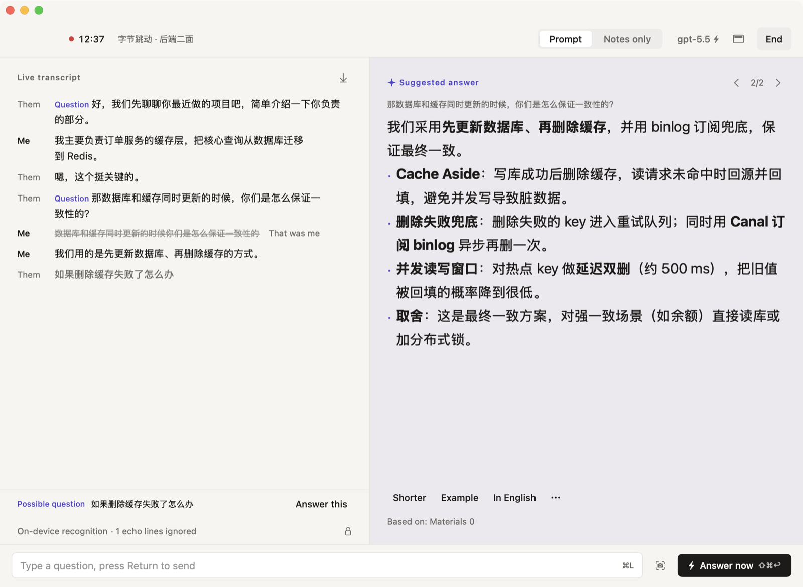
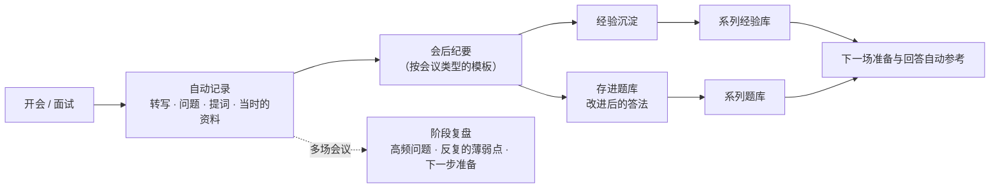

<div align="center">

# Interview Hacker

**会前读懂资料，会中递上一句话，会后留下一份纪要 · 原生 macOS**

面试、答辩、组会、工作会议、客户沟通、讲座，线上线下都能用<br>
听对方说话 → 本机实时转写 → 判断“这是不是在问我” → 递上可以直接说出口的回答 → 会后按场景整理纪要


**[⬇️ 下载最新版本](../../releases/latest)** · [界面导览](#界面导览) · [安装](#安装) · [快速上手](#快速上手) · [会议类型与系列](#会议类型与系列) · [复盘与自我迭代](#复盘与自我迭代) · [数据与备份](#数据与备份) · [隐私](#数据去向)

<br>



</div>

---

## v2.1.0：更专注的会议记录

会议归档支持按系列浏览、点击面包屑返回上级、查看会议详细信息，并可收起侧边栏来专注阅读纪要。资料夹和设置页会随窗口宽度调整布局，卡片尺寸与边缘保持整齐。会议中可启用本机中英同声传译，自动识别双方语言并双向翻译；中断的纪要整理任务会在下次启动后恢复。应用名称显示为 **Interview Hacker**，原有资料、会议记录和模型继续兼容。

[v2.1.0 发布说明](docs/releases/v2.1.0.md) · [更新日志](CHANGELOG.md)。

## v2.0.0：一场会议就是一页

整个界面按“纸与墨”重新设计：暖白纸底、近黑墨色，紫色只用来标出 AI 写的内容。每场会议就是一页，自己经历 **准备 → 进行中 → 纪要** 三个阶段；会中窗口只留这场对话。新增 8 种会议类型与“系列”（二面自动接上一面的资料、复盘和经验）、线下会议、单独的会后纪要模型与场景模板，以及中英文界面。

v2.0.1 修复了中文系统上界面显示成英文的问题，“立即记录”改为 ⌘⇧N。

[v2.0.1 发布说明](docs/releases/v2.0.1.md) · [v2.0.0 发布说明](docs/releases/v2.0.0.md) · [设计文档](docs/redesign/README.md) · [更新日志](CHANGELOG.md)。原有资料、题库、记录和模型继续兼容。

<details>
<summary>更早的版本</summary>

## v1.8.0 简洁设置与实时对话引导

全部设置采用简洁默认与统一的“高级设置”开关。首次安装和功能版本升级会展示五步引导：认识助手 → 准备语音 → 连接对话 → 资料可选 → 开始辅助。语音与对话是核心能力；OCR、向量检索按需启用，清楚标明已安装、需下载和正在使用，并解释下载、内存、网络与额度的取舍。

[设置设计与完整分层](docs/SETTINGS-DESIGN.md) · [验证范围](docs/VALIDATION-SETTINGS.md) · [发布与升级验证](docs/VALIDATION-v1.8.0.md)。沿用 v1.7.0 的固定文档运行包和模型，无需重新下载已经安装的组件。

## v1.7.0 文档与本地检索

设置 → 资料：默认系统 OCR，无需下载权重；可选 Paddle Q8 + 版面检测，或使用本机 Codex CLI 的 **gpt-6-luna** 在线代读原文件。Codex 通过隔离的只读工具按需读取 PDF、Office 和图片，原件临时副本在任务结束后删除。不会自动把本地失败转成在线调用。

Qwen3-Embedding-0.6B Q8 为资料增加本地语义检索。全部模型约 **1.88 GB**；Python 与依赖运行包另约 **186 MB 下载／632 MB 安装**，应用管理，用户无需 Python、pip 或 Homebrew。模型可取消下载、修复或删除；资料长期只保存完整 Markdown 与定位元数据。基础 TXT、Markdown 和系统 OCR 不依赖运行包。

已经下载过？设置 → 资料 → **扫描本机已有组件**：查找常见下载目录、隐藏模型缓存及系统索引中的兼容文档模型与运行包；外置磁盘或未找到的位置可选择目录。仅复用当前固定版本且逐文件 SHA-256 校验一致的资产，保留原文件。准备组件时也会先查找本机，缺失或损坏部分才下载；扫描不会自动开启 OCR／语义检索。受权限、索引与扫描预算限制，未发现不代表整台电脑没有文件。

[处理管线与限制](docs/DOCUMENT-MARKDOWN-PIPELINE.md) · [六份实际对照、原始输出与验证报告](docs/VALIDATION-v1.7.0.md)。本次在 M2 Pro 16 GB／macOS 26.5.2 验证；macOS 14 为兼容目标，尚无该系统真机结果。

## 最近更新

- **联网搜索（v1.5）**：先立刻给出快速回答；问到价格、新闻、版本、现任人员、“今天 / 最近”这类需要最新信息的问题时，在后台联网（Codex 实时搜索或 Tavily），查好后自动换成联网版，可随时切回原回答。
- **模块与布局（v1.5）**：助手页的 实时对话 / 当前问题 / 建议回答 / 回答记录 可以选预设布局、拖动空隙调整大小、隐藏，或弹出为独立小窗。
- **屏幕感知与讲稿跟随（v1.6）**：讲 PPT 时自动认出当前页，给出这一页的要点、过渡句和可能被问的问题，讲过的要点自动打勾；屏幕上的题目、代码和对话相关时纳入回答。还会提示回答讲到哪一句。
- **API 预设 + 技能（v1.5）**：保存多家服务商（地址、Key、模型、思考强度）一键切换；导入自己的 SKILL.md 全局或按场景使用。
- **回答更像人话（v1.5）**：按“照着说出口”来写，第一人称、短句，不再是提纲和 AI 套话；你说的话被误判为回声时会灰色显示，点“是我说的”恢复。
- v1.4：新手引导、设置左右布局、Codex Fast 模式、切换页面不闪烁。v1.3：场景分区与五种模式、会后复盘与自我迭代、数据备份。

完整说明见 [更新日志](CHANGELOG.md)。

</details>

## 界面导览

> 截图来自 App 的演示模式（示例数据，不采集声音、不调用模型），由 `scripts/capture-screenshots.sh` 生成，统一使用浅色外观。

一场会议就是一页，会自己经历三个阶段：**准备 → 进行中 → 纪要**。窗口左边是侧边栏：**首页 · 所有会议 · 资料夹**，**设置**在最下面（也可以按 ⌘,）。界面语言在 设置 → 基础 → 语言 里切换（跟随系统 / 简体中文 / English）。

### ① 首页：马上要开会了



- **新会议**（⌘N）：进入准备页。**立即记录**（⌘⇧N）：不选类型、不加资料，马上开始，结束后自动出纪要。
- 下面是最近两场会议和它们的结果（几个待办、几道题待改进）。
- 接日历之后这里会显示“下一场会议”（第二步）。

### ② 准备页：一页从上往下



1. **这是什么会**：通用、面试、汇报 / 答辩、组会、工作会议、客户沟通、讲座 / 课程、小组讨论，或自定义。选了类型，会中默认（提词还是只记录）、回答长度和纪要模板就跟着定好；输入标题时会先猜好类型。
2. **接着上一场**：标题像以前的某个系列（例如“字节跳动 · 后端二面”接“字节跳动 · 后端”）时出现，勾选带入资料、复盘（题库）、经验，完整转写默认不带。不是同一件事就点“不是同一个系列”；也可以“从以前的会议带入…”。
3. **这次新加的资料**：拖进来就开始读，显示“读取中 → 已读懂”；读完可以让 AI 写出“读到的重点”和“可能会问”的题。
4. **开始前检查**：声音（线上 / 线下）、回答（当前模型，开着快速模式时标出）、手机（开启手机伴侣时）。

页面底部只有一个按钮：**开始**。资料没读完也能开始；录屏和麦克风权限在第一次开始时就地申请。

### ③ 会中：只留这场对话


- 开始后窗口进入**专注模式**：侧边栏收起，整个窗口只属于这场会议。⌘, 打开的设置是单独的小窗口。
- **顶栏**：计时（点一下暂停）、会议标题、**提词 / 只记录**、手机状态（开启手机伴侣时）、模型标签（点开“回答设置”：模型、快速模式、联网、回答长度，从下一个回答开始生效）、提词器、结束。
- **左栏**是实时对话（对方 / 我；线下会议标“现场”），被识别为问题的句子标“问题”；**右栏**是建议回答：头部 ‹ 2/5 › 翻看本场的回答，需要联网时才出现“正在联网核查…”，下方是 更简短 · 举例 · 英文版 和“…”（其余改写、重新生成、联网查一下、复制），底部一行写依据。
- **底部**一行输入框（⌘L）、截图（框选区域 / 选择窗口）和全窗口唯一的主按钮 **立即回答**（⌘⇧↩）。
- **只记录**时右栏保持安静，需要时按 ⌘⇧↩ 或输入问题。



**提词器**放在摄像头下方，看着镜头就能读：底部是三个改写、“…”（复制、打开主窗口……）和一个“立即回答 / 停止生成”按钮。可以调字号、开鼠标穿透（只有控制穿透的那个按钮不穿透），⌘⇧\ 一键隐藏全部窗口。

### ④ 声音从哪来

- **线上（默认）**：对方 = **电脑声音**（这台 Mac 播放的所有声音，App 自己的声音会被排除），不管用的是腾讯会议、飞书、Zoom 还是网页会议；我 = 麦克风。电脑还放着别的声音时，才需要改成“只听某个窗口…”。
- **线下**：大家在同一个房间，只用麦克风，转写标“现场”，默认只记录。纪要只在原话里点了名时才把事情归到具体的人。
- 音频只在本机识别，**不保存录音**。

### ⑤ 会后：结束就是纪要



点“结束”后同一场会议直接变成纪要页，纪要在后台整理（通常 1–3 分钟），分三步：

1. **校对转写**：结合资料里的专有名词纠正识别错误。改过的地方在转写里用虚线标出，悬停能看到原来识别的内容，右键可以撤销。不重新识别声音，也不保存录音。
2. **按模板整理**：面试复盘、学术（组会 / 答辩 / 汇报）、工作会议、客户沟通、讲座 / 课程、小组讨论、通用，也可以自己建模板。每一条都带原话的时间点，点一下跳回转写。每个模板都有“不足”这一部分（答得不好 / 讨论不透彻 / 风险和未决）。
3. **核对**：没有原话依据的条目删掉；“周四交付”这类相对日期按会议日期换成具体日期；人名听不清、截止时间有两种说法的标“待确认”。

纪要用单独的模型（设置 → 纪要：默认最强模型、推理“高”、不开快速模式），可以换模板或换语言重新整理。主按钮是 **复制纪要**；面试复盘是 **存进题库 · n 题**：待改进的题和更好的答法进这个系列的题库，下一场自动带入。



### ⑥ 所有会议与资料夹

- **所有会议**：以前的“记录”，可以搜索、按日期和时长筛选、排序；点开就是那场会议的纪要页（纪要 / 转写 / 会中提词）。右键一场会议可以“以此为上一场，准备下一场”。
- **资料夹**：按**系列**（同一件事的多场会议，以前叫“场景”）保存资料、回答要求、技能、经验库、题库和阶段复盘。把资料从系列里拆出来、跨会议复用放在第二步。



### ⑦ 设置



默认只保留核心选项，右上角的 **高级设置** 开关显示模型参数、联网与技能细项、备份策略和维护工具。新增 **纪要** 分组（纪要模型、何时整理、纪要语言、各类型的默认模板、自定义模板）和 **基础 → 语言**。原来的“自动回答”开关已经取消，由会中的“提词 / 只记录”代替。新手引导不再在启动时弹出，可以从 设置 → 基础 打开。完整分层见 [设置设计](docs/SETTINGS-DESIGN.md)。

### ⑧ English

切到 English 后 App 会重新打开，首页、准备、会中、纪要都是英文（少数旧的高级设置页还是中文，下个版本补齐）；建议回答仍然跟着对话的语言走。



## 功能

| | |
| --- | --- |
| 🗓 **一场会议一页** | 首页告诉你接下来做什么；准备页四步（会议类型、接着上一场、新资料、开始前检查）；会中只留这场对话；结束后同一页变成纪要。不想准备就“立即记录” |
| 🎧 **双路收音** | 对方 = 这台 Mac 播放的全部声音（任何会议软件都行，App 自己的声音会被排除），我 = 麦克风，两路独立识别，抢话也不混；自动识别并忽略扬声器回声。线下会议只用麦克风，标为“现场” |
| ⚡ **两遍本地识别** | 默认离线 X-ASR 中英流式模型边说边出字（带标点、中英混说），每句说完再用离线模型整句精修；也可选 Apple Speech（macOS 26）或云端流式（Soniox / OpenAI / Deepgram）。调研见 [ASR 模型调研](docs/ASR-MODELS-2026-10.md) |
| 🧠 **问题识别** | 区分陈述、未说完、提问、请求（“说一下你对…的理解”“walk me through…”）、追问；去掉口头禅、排除自问自答和“能听到吗”；问句结尾约 0.6 秒内开始回答，对方补充后半句时自动改答完整问题 |
| 🌐 **联网搜索** | 先给快速回答，需要最新信息时后台联网（Codex 实时搜索 / Tavily），查好后自动换成带来源的联网版 |
| 🧠 **技能** | 导入自己的 SKILL.md，全局或按系列启用，让回答更贴合你的说话方式和答题套路 |
| ✍️ **流式回答** | 常驻 Codex 服务或任意 OpenAI 兼容 API（DeepSeek / 通义 / Kimi / Groq / Ollama…）逐字输出，显示首字耗时；会中点模型标签打开“回答设置”：换模型、开关 **快速模式**（Codex，约 1.5 倍速度）、联网、回答长度 |
| 🗂 **会议类型与系列** | 8 种会议类型加自定义，决定会中默认、回答长度和纪要模板；同一件事的多场会议归为一个系列，共享资料、经验库和题库，下一场勾选带入 |
| 🧾 **会后纪要** | 单独的纪要模型：AI 校对转写 → 按场景模板整理（面试复盘、学术、工作会议……）→ 核对；每条引用原话时间点，相对日期换成具体日期，不确定的标“待确认” |
| 🌏 **中文 / English** | 设置 → 基础 → 语言 切换界面语言；建议回答跟着对话的语言走 |
| 📄 **资料检索** | PDF 含扫描件 OCR、Word、PPT、Excel、CSV、HTML、图片等统一转成**结构化 Markdown**（本机完成；装了 MarkItDown / Pandoc 会自动用上），按问题检索相关片段并标注 [分类] 文件名与页码 |
| 📥 **批量导入 · 自动归类** | 一次拖入多个文件甚至整个文件夹：自动转 Markdown、在后台静默归档成 `.md`，并按内容自动归入资料分类，不用手动分门别类 |
| 🧰 **一键配置 / 重建环境** | 高级设置 → 基础 → 环境与模型：检查回答引擎、选模型、备语音识别、刷音频来源、重建资料索引，每一步都有独立状态 |
| 📝 **会议记录** | 自动保存完整转录、识别到的问题、提词和当时的资料；“所有会议”里搜索、筛选，点开就是那场会议的纪要页，可复制或导出 Markdown |
| 🔁 **复盘与自我迭代** | 面试复盘一键存进题库，经验并入系列，下次回答参考；阶段复盘找出高频问题和反复出现的薄弱点 |
| 💾 **数据与备份** | 所有数据在本机一个文件夹；自动备份；一键导出 / 导入（.ihbackup），也可单独导出某个系列 |
| 🔄 **自动更新** | 定期检查 GitHub Releases，后台下载并校验，点“重启以更新”即可；可绑定本机签名，更新后不再重新授权 |
| 🪄 **一键调整** | 回答下方露出 更简短 · 举例 · 英文版，其余（展开、STAR、中文版、澄清问题、我可以反问、重新生成、联网查一下）在“…”里；准备页可以让 AI 写出“可能会问”的题 |
| 🪟 **提词器** | 悬浮窗，可放在摄像头下方，鼠标穿透（穿透时控制按钮本身仍可点），可隐藏背景，历史翻页，一键隐藏全部窗口 |
| 📱 **手机伴侣** | 扫码即用，手机实时显示回答并可遥控；会中顶栏显示手机是否已连接。如果共享手机屏幕或把手机镜像到 Mac，仍可能被看见 |
| 📸 **截图提问** | 窗口或区域截图，适合代码题、数学题、幻灯片 |
| ⌨️ **全局快捷键** | 全部可自定义，见[下表](#快捷键) |

## 会议类型与系列

准备页第一步是“这是什么会”。选了类型，会中默认、回答长度和纪要模板就都定了，不用再碰别的开关。日历标题里有“面试”“组会”“答辩”“lecture”这类词时会先替你选好；猜不出来就是“通用”。

| 类型 | 会中默认 | 回答长度 | 纪要模板 | 准备时提示放什么 |
| --- | --- | --- | --- | --- |
| **通用**（默认） | 只记录（⌘⇧↩ 随时回答） | 要点 | 总结 · 决定 · 待办 · 未决问题 | — |
| **面试** | 提词 | 要点 | 面试复盘：逐题回放 · 说得不好的地方 · 没讲到的点 · 下次改进 | 简历、职位描述、公司信息 |
| **汇报 / 答辩** | 提词 | 要点 | 学术：听众问了什么 · 讨论得不够透彻的 · 下一步 | 讲稿、PPT、论文 |
| **组会** | 只记录 | 详细 | 学术：导师的意见 · 下一步论文 / 实验 · 截止时间 | 本周进展、相关论文 |
| **工作会议** | 只记录 | 要点 | 决定 · 待办（谁 · 做什么 · 哪天交付）· 风险 | 议程 |
| **客户沟通** | 提词 | 要点 | 客户需求 · 顾虑 · 我们答应的 · 下一步 | 产品资料、报价 |
| **讲座 / 课程** | 只记录 | 详细 | 要点大纲 · 关键概念 · 我的疑问 | 课件 |
| **小组讨论** | 只记录 | 要点 | 各方观点 · 结论与分歧 · 分工 | 讨论题目 |
| **自定义…** | 自选 | 自选 | 从上面任选一种做基础 | — |

**系列 = 同一件事的多场会议**，比如“字节跳动 · 后端”（一面、二面、三面）、“周组会”、“某客户合作”。系列共享资料、题库和经验；每场会议的转写和纪要各自独立。新建“字节跳动 · 后端二面”时，准备页会认出它属于哪个系列，并默认勾上一场的资料、复盘和经验（完整转写默认不勾），AI 写的“重点”会提到上一场卡在哪。没认出来时，在准备页“从以前的会议带入…”，或在所有会议里右键“以此为上一场，准备下一场”。以前的“场景”就是系列，旧数据原样沿用。

## 复盘与自我迭代



- 面试复盘的主按钮是“存进题库 · n 题”；复盘里的经验默认并入这场会议所属的系列（设置 → 数据 可关闭）。
- 经验和题目会去重合并，相近的问题（“怎么”和“如何”这类说法差异）只保留一条并更新答案。
- 资料夹里每个系列的“经验库与题库”可以手动添加、编辑、删除；置顶的经验会优先交给模型。

## 数据与备份

- 所有数据都在 `~/Library/Application Support/InterviewHacker`：`Workspaces/`（系列）、`Sessions/`（会议记录与纪要）、`Backups/`（自动备份）、`models/`（识别模型）。更新应用、更换识别模型或回答接口都不会改动它们。
- **自动备份**：每天一次，安装更新前、导入前各一次，保留最近 10 份；删除的系列也会在 `Backups/deleted-workspaces` 留一份。
- **导出 / 导入**：设置 → 数据 →“导出全部”生成一个 `.ihbackup` 文件（可选是否包含 API Key）；换电脑或重装后“导入”即可。导入只合并、不删除，同一系列以较新的修改为准。
- 从 v1.x 升级到 v2.0 不需要迁移：资料、题库、记录和模型直接沿用。

## 安装

1. 到 **[Releases](../../releases)** 下载 `InterviewHacker-<版本>-macOS-arm64.dmg`，打开后把 Interview Hacker 拖进“应用程序”。（正式版本使用版本号 Release；旧的 `main-latest` 保留为历史构建。）
2. 第一次打开：应用未经 Apple 公证，macOS 会拦截。打开 **系统设置 → 隐私与安全性**，在页面底部点 **“仍要打开”**。
   也可以在终端执行：`xattr -dr com.apple.quarantine /Applications/InterviewHacker.app`
3. 按提示允许 **屏幕与系统音频录制** 和 **麦克风**。授权后如系统要求重启应用，照做即可。

> 需要 Apple Silicon（M 系列芯片）和 macOS 14 或更新版本。Apple Speech 流式识别需要 macOS 26。

### 更新（不用每次重新授权）

**应用内自动更新（推荐）**：设置 → 更多 → 自动更新。应用启动后和每 6 小时检查一次 GitHub Releases，发现新版本就在后台下载并校验 SHA-256 与签名，顶栏出现“重启以更新”，点一下即替换并重新打开。仓库是私有的，需要在同一页的“高级设置 → GitHub 访问”填一个只读访问令牌（fine-grained token，只勾选本仓库的 Contents: Read-only），或在终端 `gh auth login` 过。

**绑定本机签名（一次即可）**：设置 → 基础（打开“高级设置”）→ 使用前检查 → 本机签名 “绑定”（或 设置 → 更多 → 权限与签名）。应用会在本机生成一个只属于这台 Mac 的代码签名证书并重新签名自己；之后自动更新下载的每个新版本都会用同一证书重新签名，macOS 认为它是同一个应用，录屏和麦克风权限一直有效。绑定后需要再授权一次，系统可能请求一次登录密码以信任该证书。

本机源码构建 `./scripts/build-app.sh` 使用这台 Mac 在应用设置中绑定的 **InterviewHacker Local Signing** 证书（位于 `~/Library/Application Support/InterviewHacker/Signing/`）。如果尚未绑定或身份文件不完整，构建会停止；请先打开应用完成绑定。不要为本机构建另建证书，这样已授予的系统权限才能继续对应同一签名身份。

也可以用命令行更新（需要已登录的 [GitHub CLI](https://cli.github.com)）：

```sh
./scripts/install-latest.sh
```

它通过 `gh` 下载最新版、校验 SHA-256，再用这台 Mac 已绑定的 Local Signing 证书重签后替换 `/Applications/InterviewHacker.app`。如果当前安装包使用了不同签名身份，脚本会停止，避免更新后丢失系统权限。安装后会重新打开应用；这样下载的文件不带浏览器的“来自互联网”标记，**不会再弹“仍要打开”**。

**为什么浏览器下载的版本每次都要重新授权？** macOS 的录屏 / 麦克风权限绑定在应用的**签名身份**上。没有固定证书时，CI 只能临时（ad-hoc）签名，每个版本的签名都不同，系统就把它当成新应用。在自己的 Mac 上运行一次：

```sh
./scripts/setup-release-signing.sh
```

它会为 GitHub Releases 使用一张固定的发布证书，并保存到仓库的 Actions Secrets，之后发布的每个版本都用同一身份签名。它与这台 Mac 上的 Local Signing 证书分开；本机证书不会上传到 CI。需要完全免除 Gatekeeper 提示时，可加入 Apple Developer Program 并配置 Developer ID 与公证（见 [开发文档](docs/DEVELOPMENT.md#签名与公证)）。

## 快速上手

打开后就是**首页**，不再先弹新手引导。

1. **准备一场会**：点 **新会议**（⌘N），选会议类型，起个标题，把简历、职位描述、讲稿等拖进“这次新加的资料”。等 AI 读完，“我读到的重点”和“可能会问”会出现在下面。只想记个纪要就点 **立即记录**（⌘⇧N），跳过这一步。
2. **看一眼开始前检查**：
   - **声音**：线上会议听这台 Mac 播放的所有声音加麦克风；线下会议只用麦克风。本机识别模型第一次需要下载（约 270 MB，来自 sherpa-onnx 官方发布并校验 SHA-256），也可以在设置里换 Apple Speech（macOS 26）或云端识别。
   - **回答**：显示当前模型。还没配好时点 **去连接**：有 ChatGPT 账号选 **Codex**（推理强度建议 `low`，想更快打开快速模式）；否则选 **API Key**，点“常用”选服务商并填模型和 Key，再点 **测试回答**。
   - **手机**：开启手机伴侣时显示是否已连接。
3. **点开始**：第一次开始时会就地申请“屏幕与系统音频录制”（听对方）和麦克风（听你自己）。建议顺手在 设置 → 基础 “绑定本机签名”，以后更新不用重新授权。
4. **会中**：提词模式下对方一提问就出回答，随时按 **⌘⇧Return** 立即回答，**⌘⇧O** 打开提词器。
5. **结束**：同一页变成纪要。面试的话，点“存进题库”，下一场自动带入。

新手引导仍在 **设置 → 基础**，想按步骤走一遍可以从那里打开。

### 快捷键

| 快捷键 | 动作 |
| --- | --- |
| ⌘N | 新会议（进入准备页） |
| ⌘⇧N | 立即记录（跳过准备，马上开始） |
| ⌘L | 会中跳到输入框 |
| ⌘, | 设置 |
| ⌘⇧Return | 立即回答（输入框 → 最新问题 → 最近转写） |
| ⌘⇧O | 显示 / 隐藏提词器 |
| ⌘⇧\ | 一键隐藏全部窗口（再按恢复） |
| ⌘⇧K | 提词器鼠标穿透 |
| ⌘⇧1 | 把回答改短 |
| ⌃⌘← / ⌃⌘→ | 上一条 / 下一条回答 |
| ⌘⇧Y | 复制回答 |
| ⌘⇧M / ⌘⇧P | 开始停止 / 暂停恢复 |
| ⌘⇧Esc / ⌘⇧R | 取消 / 重新生成 |
| ⌘⇧A / ⌘⇧S | 窗口截图 / 区域截图 |

### 屏幕共享时怎么看回答

- **共享单个窗口或浏览器标签页**：对方看不到提词器，最推荐。
- **共享整个屏幕**：设置里的“尽力从屏幕共享中排除”对很多软件有效，但 macOS 没有能保证排除录屏的公开接口，macOS 15 起部分整屏共享仍可能拍到。用 **设置 → 提词器 → 共享可见性测试** 自己确认；最稳妥是开 **手机伴侣** 用手机看。

## 数据去向

| 数据 | 去向 |
| --- | --- |
| 原始音频 | 默认只在本机识别，不保存。选择云端识别并勾选同意后，实时上传到你选的服务商 |
| 转录、问题、检索到的资料片段、截图、启用的技能 | 发送给你选的回答引擎（Codex 或你配置的 API） |
| 联网搜索 | 开启后，需要最新信息的问题会交给 Codex 联网搜索，或发送到 Tavily 搜索（只发问题文本） |
| 导入的资料 | 在本机解析，随所属系列保存在本机 |
| API Key（每个预设、Tavily） | 系统钥匙串 |
| 手机伴侣 | 默认关闭；只同步当前问题和回答，链接含一次性随机配对码，局域网明文 HTTP |
| 会议记录、系列、备份 | 全部在本机 `~/Library/Application Support/InterviewHacker`（不含音频）；可在 设置 → 数据 关闭记录、导出 / 导入或删除 |
| 会后纪要 | 默认开启：会议结束后把这次的转写（和这场会议的资料片段）发给 设置 → 纪要 里选的模型，校对并整理纪要；可在 设置 → 纪要 关闭“会议结束后自动整理” |
| 更新检查 | 访问 api.github.com 读取本仓库的 Releases；访问令牌保存在钥匙串 |

请遵守会议、课程、考试和面试方的规则，并在录音和转写前取得参与者同意。本软件不宣称“无法被检测”。

## 常见问题

<details>
<summary><b>每次更新都要重新允许录屏 / 麦克风？</b></summary>

macOS 把权限绑定在应用的签名身份上。最简单：在 设置 → 基础 的“本机签名”一行点“绑定”，再用应用内更新，以后都不用重新授权。维护者也可以运行一次 `./scripts/setup-release-signing.sh`，让发布的版本都用固定签名。详见上方[更新](#更新不用每次重新授权)。
</details>

<details>
<summary><b>点“开始”要等很久？</b></summary>

本机模型首次下载约 270 MB，随后会从 Application Support 加载并在后台预热；识别耗时、RTF 和整句精修耗时显示在对话区顶部。设置 → 识别（打开右上角“高级设置”） 里可关闭后台预加载以减少空闲时的内存占用。
</details>

<details>
<summary><b>摘戴耳机、切换 AirPods 后会断吗？</b></summary>

不会。麦克风会自动跟随系统默认输入设备，系统音频中断后自动重连；麦克风暂时不可用时，仍会继续识别对方的声音。
</details>

<details>
<summary><b>手机伴侣提示 “Address already in use”？</b></summary>

新版本会在首选端口被占用时自动换用下一个空闲端口。也可以在 设置 → 更多 → 手机伴侣 修改首选端口并点“重新生成链接”。手机和 Mac 需要连同一个 Wi‑Fi。
</details>

<details>
<summary><b>共享屏幕时对方会看到提词器吗？</b></summary>

只共享会议窗口或浏览器标签页时看不到。共享整个屏幕时，macOS 没有能保证排除的公开接口，部分软件仍可能拍到——用 设置 → 提词器 → 共享可见性测试 自己确认，或改用手机伴侣。
</details>

<details>
<summary><b>没有 Codex 账号能用吗？</b></summary>

可以。设置 → 回答 选“API Key”，填 DeepSeek、通义千问、Kimi、Groq、OpenRouter 的 Key，或本机 Ollama / LM Studio 地址。
</details>

## 文档

- [v2 界面重设计](docs/redesign/README.md)：视觉语言“纸与墨”、使用场景与流程、中英文文案、实现计划、设计决定，以及可以直接在浏览器打开的页面预览
- [v2.0.0 发布说明](docs/releases/v2.0.0.md)
- [开发与发布](docs/DEVELOPMENT.md)：项目结构、构建、打包、签名与公证、发布流程、`--self-test` 自检
- [用自己的 Mac 当构建机](docs/SELF-HOSTED-RUNNER.md)：`./scripts/setup-ci-runner.sh` 一键注册，构建 / 测试 / 发布不再消耗 GitHub 的 macOS 分钟数
- [v1.6.0 发布说明](docs/releases/v1.6.0.md)
- [v1.3.0 发布说明](docs/releases/v1.3.0.md)
- [本地语音识别模型调研（2026-10）](docs/ASR-MODELS-2026-10.md)：X-ASR / Qwen3-ASR / FireRedASR2 / SenseVoice / Whisper 对比与实测，回声与抢话处理
- [第二轮改进说明](docs/IMPROVEMENTS-2026-10-14-round2.md)：流式回答、问题识别、云端识别、手机伴侣等设计与验收清单
- [第一轮代码审计](docs/AUDIT-2026-10-14.md) · [历史验证记录](docs/VALIDATION-2026-10-14.md) · [更新日志](CHANGELOG.md)
- 问题反馈与功能建议：[Issues](../../issues/new/choose)

## 从源码构建

需要 Apple Silicon 和 Swift 6 工具链（Xcode，或只装 Command Line Tools 也可以）：

```sh
swift test --disable-sandbox     # 运行测试
./scripts/build-app.sh           # 生成 dist/InterviewHacker.app 与 ZIP（会编译中英文界面文字）
open dist/InterviewHacker.app
./scripts/capture-screenshots.sh # 可选：用演示模式重新生成 README 截图
```

详见 [docs/DEVELOPMENT.md](docs/DEVELOPMENT.md)。

## 致谢

本地语音识别使用 [Sherpa-ONNX](https://github.com/k2-fsa/sherpa-onnx) C API 和 Apache-2.0 的 [X-ASR](https://github.com/Gilgamesh-J/X-ASR) 中英 Zipformer 模型（流式 + 离线）；ONNX Runtime 与模型的版本、来源和许可证见 [`Resources/ThirdPartyNotices.txt`](Resources/ThirdPartyNotices.txt)。
