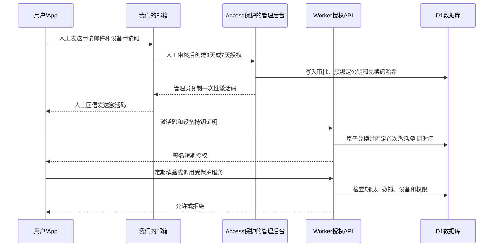

# NextThought 公测授权方案调研报告

调研日期：2026 年 10 月 24 日（Australia/Sydney）。

**后续讨论更新。** 用户现已选择“邮件交付、App 只输入一个限时 Key、授权可完全离线”，并接受专业逆向的剩余风险。当前方案见 [邮件交付限时 Key 文档](/Users/spdor/Desktop/CodeSpace/NextThought/docs/OFFLINE-LICENSE-KEY-PLAN-2026-10-24.md)。下文保留原联网方案的调研与比较；其中每五分钟连接 Cloudflare、短期续验和核心服务上云的建议不再作为当前默认实施要求。新文档区分持 Key 授权与发码前设备绑定，并明确完全离线无法自动实现全球唯一的首次绑定。

业务前提：少于 100 位公测用户；用户通过邮件申请；人工审核、人工发送激活码；后台可设置 3 天或 7 天、延期、撤销和设备限制；优先使用 Cloudflare 免费服务；希望中国大陆和海外用户均能直接使用。

研究范围：阅读 GitHub 授权项目的文档、部分授权和数据库代码，以及 Cloudflare、Apple、OWASP 官方资料；检查本地 NextThought 的调用路径。本报告是一份设计和选型结果。下文的验收项目尚未执行，候选仓库的测试结果与安全审计声明也未经本次独立复现。

**建议与保护范围。** 使用 Cloudflare Workers、D1 和 Access 建立人工发码与授权后台是可行的。推荐采用“设备申请码预绑定、一次性激活码、首次激活计时、短期签名授权、服务端逐次检查关键操作”的设计。

对“万无一失、绝不能免费破解”无法作出保证：用户掌控自己的电脑，可以修改客户端。服务端能够可靠控制其管理的授权和远端资源；完全存在于用户电脑上的功能仍可能被修改后运行。OWASP 要求关键授权在服务端执行，并在每次请求时验证权限；混淆和反调试只能增加逆向难度。[OWASP 授权指南](https://cheatsheetseries.owasp.org/cheatsheets/Authorization_Cheat_Sheet.html) · [OWASP 防逆向与篡改说明](https://mas.owasp.org/MASVS/11-MASVS-RESILIENCE/)

**本项目目前最重要的约束。** 本地基线为提交 `06a6d1256798a9ba96b3294a834944d0c340c200`，提交日期 2026-10-23。GitHub 连接器确认项目目前位于 `OmnixSI/NextThought`，仓库为私有。

当前回答客户端直接向用户指定的模型服务发送请求；还支持本机 Codex 和本地模型路径。问题组织、提示构造等逻辑也在本地。对 Swift 源码的关键词检查未发现现有的兑换码或商业许可证控制模块。相关证据见 [AnswerEngines.swift:363](/Users/spdor/Desktop/CodeSpace/NextThought/Sources/NextThought/AnswerEngines.swift:363)、[AnswerEngines.swift:172](/Users/spdor/Desktop/CodeSpace/NextThought/Sources/NextThought/AnswerEngines.swift:172)、[AnswerPromptBuilder.swift:36](/Users/spdor/Desktop/CodeSpace/NextThought/Sources/NextThoughtCore/AnswerPromptBuilder.swift:36)。

因此，增加授权后台可以管理正常客户端的访问期限，但仅在启动时调用一次授权 API，无法建立完整的防绕过边界。已经交到用户手中的旧版本，如果能直接使用用户自己的 API Key 或本机 Codex，也不会因为新版本增加激活功能而自动失效。服务器拒绝旧版本请求、客户端自检签名和更新提示，都无法远程收回旧版本已有的完整本地能力。

正式公测应明确保护目标：如果必须让过期用户无法继续使用核心服务，就需要让核心功能依赖真正由我们控制的远端处理或资源，并封住能提供同等完整功能的旁路。仅把一个布尔值、配置或解密后的提示词从云端交回本地，仍然容易被缓存或替换。现有 BYOK、本机 Codex 和离线能力的取舍，应作为后续产品设计决策，不能在报告中假定它已经解决。授权服务本身不应接收用户的模型 API Key、Codex 登录凭证、录音、截图或简历。

**GitHub 上已有的相近实现。** 下表区分实际读取的内容与适用范围。仓库自述“安全”“生产可用”均不等于独立审计结论。

| 项目 | 已核对的实现 | 对本项目的价值与差距 |
| --- | --- | --- |
| [bmpenuelas/workers-license-server](https://github.com/bmpenuelas/workers-license-server) | Workers + D1；管理界面；人工创建许可证；Ed25519 授权凭证；设备名额；续验和撤销；有客户端示例及自述审计记录。读取 README、授权服务、管理接口、数据库和安全说明。 | 最接近完整参考。当前人工发码接口在签发时计算到期日；设备主要依赖安装 ID；离线和续验间隔以“天”为单位。需要改成首次激活计时、设备持钥证明、分钟级短期授权，并明确已签发授权的政策快照。详见 [人工发码代码](https://github.com/bmpenuelas/workers-license-server/blob/ee12b26aeb06200d70bf89629fb9703a4b8b9ebf/src/admin.ts)、[授权服务](https://github.com/bmpenuelas/workers-license-server/blob/ee12b26aeb06200d70bf89629fb9703a4b8b9ebf/src/licensing-service.ts)、[客户端约定](https://github.com/bmpenuelas/workers-license-server/blob/ee12b26aeb06200d70bf89629fb9703a4b8b9ebf/docs/CLIENT-INTEGRATION.md)。 |
| [zijinan/cloudflare-workers-d1-license-server](https://github.com/zijinan/cloudflare-workers-d1-license-server) | 设备先生成申请码，管理员据此预绑定公钥并发码；P-256 设备签名、防重放、Ed25519 响应签名、撤销和管理员换绑。读取 README 和 Worker 核心代码。 | 与人工邮件审核很契合。当前创建接口明确只支持永久授权，拒绝传入期限；响应也没有独立的短期租约到期字段。公开仓库不提供自动化测试，不能直接满足 3/7 天需求。详见 [项目说明](https://github.com/zijinan/cloudflare-workers-d1-license-server/blob/82cae3621723874c53309e7249e7dd92519dbf08/README.md)、[创建与签名逻辑](https://github.com/zijinan/cloudflare-workers-d1-license-server/blob/82cae3621723874c53309e7249e7dd92519dbf08/src/index.ts)。 |
| [heictojpgpics/diskgenie-license-server](https://github.com/heictojpgpics/diskgenie-license-server) | 桌面软件案例；Workers + D1；激活码哈希；设备名额；Ed25519 凭证；定期续验；人工管理 API。读取 README、请求验证和令牌生成代码。 | 可参考桌面接入和数据库唯一约束。其默认 14 天离线窗口不适合短期公测；请求共享密钥会随客户端分发，不能作为可信客户端的证明；硬件信息采集也明显多于本项目所需。详见 [设计说明](https://github.com/heictojpgpics/diskgenie-license-server/blob/7b914480f677a41f921a9a5c29ed7bedab65172e/README.md)、[请求验证](https://github.com/heictojpgpics/diskgenie-license-server/blob/7b914480f677a41f921a9a5c29ed7bedab65172e/src/guard.ts)、[令牌期限](https://github.com/heictojpgpics/diskgenie-license-server/blob/7b914480f677a41f921a9a5c29ed7bedab65172e/src/tokens.ts)。 |
| [hwdemtv/hw-license-center](https://github.com/hwdemtv/hw-license-center) | 文档描述 Workers/D1 与 Node/SQLite 部署、人工卡密管理和 AI 网关。此次读取 README 和接入文档，未完整审查服务端。 | 可参考管理流程和将模型服务放到受控网关的方向。当前接入文档指导客户端只解码 JWT 字段，并提到 MockSignature；这不能验证授权真实性。该接入示例不应直接用于高价值软件。详见 [固定版本接入文档](https://github.com/hwdemtv/hw-license-center/blob/34d20d628241e87bac2317ed7a5b8509cf7c2ff0/docs/INTEGRATION.md)。 |
| [keygen-sh/keygen-api](https://github.com/keygen-sh/keygen-api) | 长期维护的授权 API，支持许可证、设备、权限和托管/自托管方式；官方称 Fair Source。 | 适合参考授权模型。其自托管体系使用 Docker、PostgreSQL、Redis 等，不适合直接移植为一个 Worker。采用其源码前需核对具体版本许可证，不能按 MIT 项目处理。[仓库说明](https://github.com/keygen-sh/keygen-api) · [部署文档](https://keygen.sh/docs/self-hosting/) |

前两个参考仓库分别创建于 2026-09-08 和 2026-10-13，项目历史较短。推荐借鉴其明确的实现模式，按本项目需求审查和裁剪；暂未找到一份已经独立验证、同时满足本报告全部要求的即用模板。第一个项目的“安全审计”也是仓库内的自述材料，并明确排除了生产渗透测试保证。[其审计范围与剩余风险](https://github.com/bmpenuelas/workers-license-server/blob/ee12b26aeb06200d70bf89629fb9703a4b8b9ebf/docs/SECURITY-AUDIT.md)

**建议的日常流程。** 邮件申请、人工审核、人工回信继续作为业务流程。为减少激活码被转发或抢先兑换的风险，建议申请邮件同时附上 App 生成的设备申请码。

1. 用户首次打开 App，在本机生成设备密钥。App 提供“复制申请信息”，内容包含设备申请码和产品版本；用户通过现有邮箱发给我们。
2. 我们人工审核邮件，在管理后台建立一条审批记录。后台显示该邮箱和设备是否曾获得试用，辅助识别重复申请。
3. 我们选择 3 天或 7 天，后台创建绑定该设备公钥的一次性激活码。原码只在创建成功时显示一次，由我们手动复制到回信。
4. 用户输入激活码，App 使用设备私钥完成服务器挑战签名。服务器检查代码、审批、设备证明和可兑换期限。
5. 首次兑换成功时，数据库原子地记录激活时间和绝对到期时间，并把兑换码标记为已使用。同一设备因断网重试时恢复同一份授权，不重复计时。
6. App 获得短期签名授权，运行期间定期续验。新建关键远端操作时，服务端再次检查当前授权状态。
7. 到期后，后台停止签发新授权并拒绝新的受保护远端操作。需要延期、换机或恢复时，由我们人工处理并记录原因。

设备申请码只含公钥和公开标识，不含私钥或硬件序列号。预绑定可防止拿到邮件中的激活码后，换一台电脑直接抢先激活；它不能证明使用者一定是原始申请人，也不能证明客户端没有被修改。

**建议先固定的授权规则。** 以下是本报告提出的初始配置，属于待实现、待验收的设计值，不是候选项目默认值。

| 规则 | 建议值及含义 |
| --- | --- |
| 试用长度 | 3 天等于 72 小时；7 天等于 168 小时。统一按服务器 UTC 时间计算，避免时区和夏令时影响。 |
| 起算点 | 首次成功兑换；发码时间和用户电脑时间均不能决定起算点。 |
| 兑换码领取窗口 | 签发后 7 天内兑换；与兑换后的试用期限分别管理。过期领取窗口由人工重新审核。 |
| 设备数 | 默认 1 台，发码前预绑定设备公钥。换机人工审核。 |
| 续验 | 正在使用时每 5 分钟尝试续验；没有使用核心功能时降低频率。 |
| 短期授权 | 最长 30 分钟，且绝不能晚于整份许可证的到期时间。 |
| 重启和恢复 | 新启动或睡眠恢复后，开始核心功能前联网确认；无法确认时提供重试。 |
| 网络中断 | 仅在已有短期授权仍有效的范围内暂时运行；网络错误不能延长它。 |
| 到期判定 | 每次请求比较“服务器当前时间是否大于或等于到期时间”，即时拒绝；定时清理任务未运行不能推迟过期。 |
| 明确撤销 | 收到可信的撤销/过期结果后立即停止受限功能；本机不以旧缓存覆盖明确拒绝。 |
| 撤销传播 | 关键远端接口下一次请求即检查数据库；正常客户端本地缓存最多保留至短期授权到期。不能宣称断网客户端能立即收到撤销。 |
| 重装、换码、换机 | 均沿用原授权的首次激活与到期时间。只有人工延期动作能改变期限。 |
| 历史资料 | 到期后仍允许查看和导出用户已有资料，防止授权故障损害用户数据。 |

客户端可以使用签名服务器时间和系统单调计时辅助检测时间回拨；重启后再次联网。完全离线、可回滚状态的客户端仍可能被篡改，因此服务器保护的操作始终由服务器当前时间判断。

人工审核也有边界：邮箱别名、换邮箱、换设备无法仅靠兑换码证明“同一个自然人”。后台只能提示重复邮箱、设备和审批记录，最终仍由人工决定是否再发放。

**Cloudflare 部署结构。** 建议使用两个 Worker 和一个生产 D1，另外建立完全独立的测试环境。

| 组件 | 职责 | 安全边界 |
| --- | --- | --- |
| 管理 Worker + 静态后台 | 查看申请记录、生成激活码、延期、撤销、换机、审计 | 整个 Worker 的生产及预览地址都由 Access 保护，只允许明确列出的管理员。 |
| 公共授权 Worker | 设备挑战、首次兑换、续验、受保护服务入口 | 面向 App；没有创建码、延期或管理员接口。只相信服务端授权记录和验证过的设备证明。 |
| D1 | 保存代码哈希、授权期限、设备公钥、一次性挑战和审计 | 单一权威状态；通过数据库约束和原子更新执行名额与兑换限制。 |
| Worker Secrets | 保存授权签名私钥和必要部署密钥 | 不发给 App，不放到 D1、网页资源、邮件或日志中。 |

Access 当前支持直接保护整个 Worker，覆盖其自定义域、`workers.dev` 和预览地址，适合防止只保护一个域名后被其他入口绕过。若使用基于请求头的 Access JWT，应用仍必须校验签名、签发者、受众和期限；不能只检查请求头存在。[Worker Access 保护范围](https://developers.cloudflare.com/workers/configuration/cloudflare-access/) · [Access JWT 验证](https://developers.cloudflare.com/cloudflare-one/access-controls/applications/http-apps/authorization-cookie/validating-json/)

后台可用管理员邮箱一次性验证码，也可用已启用多因素认证的身份提供方。Access 的免费 50 用户额度在此只涉及后台管理员，公测用户通过我们自己的授权 API 兑换。[邮件登录](https://developers.cloudflare.com/cloudflare-one/integrations/identity-providers/one-time-pin/) · [Cloudflare 计划说明](https://www.cloudflare.com/plans/)

授权 Worker 使用自己的稳定域名，便于将来迁移云平台。域名不会自动改善中国大陆网络路径。公开 API 需要适合原生 App 的安全策略；不能给原生请求附加必须由浏览器完成的交互挑战，也不能把 User-Agent、CORS 或固定的客户端共享密钥当成可信身份。

**设备绑定和签名。** macOS 客户端优先使用 CryptoKit 的 Secure Enclave P-256 密钥完成设备证明；授权响应使用服务端 Ed25519 私钥签名，客户端只内置对应公钥。两套密钥用途不同。Apple 说明 Secure Enclave 导出的恢复数据仍只能由原设备的 Secure Enclave 使用，适合降低直接复制设备私钥的风险。实际实现需检查 Secure Enclave 可用性，无法使用时走明确的人工处理或注明较弱的兼容模式，不能自动给一份新试用。[Apple Secure Enclave 密钥](https://developer.apple.com/documentation/security/protecting-keys-with-the-secure-enclave) · [CryptoKit 与 Keychain](https://developer.apple.com/documentation/cryptokit/storing-cryptokit-keys-in-the-keychain) · [Workers Web Crypto](https://developers.cloudflare.com/workers/runtime-apis/web-crypto/)

每次重要授权请求使用与操作及设备关联的一次性服务器挑战，初始有效期建议 120 秒；客户端签名绑定请求方法、路径、请求内容和挑战。服务端校验持钥证明并原子消费挑战，拒绝重放。激活及续验请求设置明确的长度上限，初始建议 16 KiB，并在实际读取请求体时执行。签名格式和公钥格式需固定，并用跨平台测试向量核对 Swift 与 Web Crypto 的兼容性。

短期授权至少绑定产品、许可证 ID、设备公钥摘要、功能权限、授权版本、签发时间和到期时间。客户端要验证真正的签名及所有关联字段，不能把 Base64 解码当作验签。令牌的到期时间取“服务器现在加 30 分钟”和“许可证绝对到期时间”中的较早值。公钥轮换使用固定受信任的 key ID 清单，不能接受响应临时提供的新公钥。

设备持钥证明只证明请求者能使用该私钥。用户仍可能在原机器上运行被修改的客户端，甚至通过原机转发签名请求。这是设备绑定的剩余风险。MAC 地址、设备名称、App 版本字符串及任意硬件指纹都不能替代这层证明。

**数据库与并发规则。** 推荐把以下对象分开记录，避免一次性兑换码同时承担长期登录凭证的职责。

| 对象 | 主要内容 |
| --- | --- |
| 审批记录 | 审批 ID、申请邮箱、设备公钥摘要、审批人、审批时间、备注、是否已给过试用。邮箱只向管理后台开放。 |
| 许可证 | 审批 ID、待激活/有效/撤销状态、试用秒数、首次激活时间、绝对到期时间、权限快照、授权版本。 |
| 兑换码 | 许可证 ID、唯一哈希、供客服辨认的末尾字符、领取截止时间、已发放/已使用/作废状态。 |
| 设备 | 许可证关联、公钥、摘要、绑定状态、首次使用和最近成功验证时间。 |
| 一次性挑战 | 随机标识、设备与操作关联、到期时间、消费状态；定期清理，限制恶意堆积。 |
| 审计 | 管理员身份、动作、对象、服务器时间和必要的前后变化；不保存原激活码、私钥或模型凭证。 |

激活码至少包含 128 位密码学随机量，用便于复制的分组字符表示；服务器只存 SHA-256 哈希。高熵随机码不应采用手机号、日期或顺序编号生成。原码丢失时作废并补发，沿用同一许可证，不能通过补发重新获得试用期。

首次兑换必须在数据库完成原子状态转换：校验审批、设备和领取期限；消费代码；第一次固定激活/到期时间；记录审计。两个并发请求最多产生一个首次激活结果。D1 支持事务式 `batch()`，但“条件更新影响 0 行”本身不等于 SQL 报错；实现必须检查结果，并用约束、条件依赖或触发器确保失败后不会继续签发授权。[D1 批量事务行为](https://developers.cloudflare.com/d1/worker-api/d1-database/#batch)

相同设备在响应丢失后重试，应能通过持钥证明恢复原授权。重试、续验和换绑均不能改写首次激活时间。撤销、换绑等操作增加授权版本；服务器拒绝旧版本令牌。关键授权读取直接使用 D1 主库，不把实时撤销状态仅放在边缘缓存里。Workers KV 是最终一致的，跨节点更新可能延迟，因此不适合独自执行一次性兑换和精确名额限制。[KV 一致性说明](https://developers.cloudflare.com/kv/concepts/how-kv-works/)

**核心功能如何落实服务端控制。** 推荐把远端核心处理与授权服务使用统一鉴权入口，每次请求检查数据库当前期限、撤销状态、设备和具体功能权限。单纯验证一枚尚未到期的 JWT，不足以即时感知其签发后的撤销。

对 NextThought，应列出实时回答、手动回答、截图回答、重新生成、复盘、后台任务和手机伴侣等入口，逐项确认它们最终调用的受保护资源。长时间不关闭 App 也必须受期限限制。若一条入口仍可直接调用本地已有的完整核心实现，就应在验收中明确记为可绕过，不能用“主按钮已经加锁”替代检查。

可以把有价值的专有处理留在服务端，并只返回结果。若选择由我们的网关调用模型，要另外设计模型费用上限、单用户额度、并发控制和新隐私数据流；Cloudflare 免费授权额度不包含第三方模型费用。完整保留当前本机 Codex、用户直连 API 和离线实现时，应接受这些本地能力存在被修改后继续运行的风险。

macOS 的发行签名、完整性检查、去除调试信息和适量混淆可作为附加措施。它们无法替代服务器资源控制。本项目已有的 `NextThought Local Signing` 身份、Bundle ID `com.nextthought.app` 和 designated requirement 必须稳定；授权签名密钥与应用签名证书分别管理。后续本机构建严格遵循 [AGENTS.md](/Users/spdor/Desktop/CodeSpace/NextThought/AGENTS.md)，避免授权开发导致 TCC 权限丢失。

**免费额度与可用性。** 截至调研日期，官方公布的主要额度如下。它们是产品限额，不是本项目实测结果。

| 项目 | 免费范围 | 对本方案的影响 |
| --- | --- | --- |
| Workers 动态请求 | 100,000 次/日，每次 10 ms CPU | 小规模授权请求量有余量；多次验签和签名仍要测 CPU。网络和数据库等待不计 CPU。 |
| D1 | 每日 500 万行读取、10 万行写入，合计 5 GB 存储 | 读写按行计费，索引、限流、挑战和审计均可能增加写入数。 |
| Access | 免费计划最多 50 位用户 | 本方案只让管理员占用 Access 席位。 |
| D1 Time Travel | 免费计划 7 天恢复窗口 | 还需要定期独立备份及恢复演练。 |

依据：[Workers 限额](https://developers.cloudflare.com/workers/platform/limits/)、[D1 定价](https://developers.cloudflare.com/d1/platform/pricing/)、[Access 计划](https://www.cloudflare.com/plans/)、[D1 恢复窗口](https://developers.cloudflare.com/d1/reference/time-travel/)。

按“100 人每天使用 8 小时、每 5 分钟续验”估算：每天约 9,600 次续验；若每次包含挑战与续验两个请求，约 19,200 次 Worker 请求。假设每轮最终消耗 5 行写入，则约 48,000 行/日，还要加管理、激活和清理开销。这里的 5 行只是预算假设，必须根据实际 D1 指标确认，尤其要计入索引更新。

如果 100 人全天持续在线，相同策略约产生 28,800 次续验、57,600 个请求和假设下 144,000 行写入，会超过免费 D1 写入额度。这说明“人数少”不能单独证明一定免费。需要减少无效心跳、控制日志写入和优化挑战存储，并观测实际用量。若仍超过免费能力，再评估付费或调整方案；Workers 付费计划当前从每月 5 美元起，不能未经决定就自动开通。[Workers 计费说明](https://developers.cloudflare.com/workers/platform/pricing/)

Workers Rate Limiting API 的计数是近似值，且不同 Cloudflare 节点分别计数。它适合减轻滥用，不能承担全球唯一兑换或精确设备名额的职责；这些必须由数据库执行。分布式请求也可能耗尽免费请求/写入配额，因此不能对免费服务作抗攻击可用性保证。[限流精度与节点范围](https://developers.cloudflare.com/workers/runtime-apis/bindings/rate-limit/)

**中国大陆和海外访问。** 邮件申请及回信与 App 授权请求属于不同链路。用户能收发邮件，并不能证明 App 到 Worker 的接口连通。

Cloudflare 官方说明，普通全球网络在中国大陆没有数据中心，大陆用户由境外节点提供服务，跨境访问可能出现较高延迟或较低可靠性。China Network 需要 Enterprise 额外订阅及域名 ICP 备案，并且不包含所有 Cloudflare 产品。[官方路由说明](https://developers.cloudflare.com/support/troubleshooting/general-troubleshooting/geographic-traffic-routing/) · [China Network 条件](https://developers.cloudflare.com/china-network/)

因此，Cloudflare 免费方案是否适用于本次公测，要由目标网络的实际验证决定。建议至少覆盖大陆电信、联通、移动，在不同地区和时段关闭 VPN 测试激活、续验和睡眠恢复；海外至少覆盖澳大利亚以及实际招募用户所在地区。建议先做 7 天小样本观测，临时验收目标可设为请求成功率不低于 99%、P95 不超过 3 秒，另测合理重试后的完成率。这些是拟定标准，不能视为现有测量结果或供应商 SLA。

若不能通过，需要更换或迁移用户侧授权入口，再测试。不要在 Cloudflare 不可达时自动放行无限期使用，也不要部署多个互不同步、各自都能重新兑换的授权数据库。迁移方案要保留一个权威授权状态，并测试跨区域连接；自定义域名、反向代理和更换域名本身都不是大陆可用性的保证。

**常见绕过与预期结果。** 下表描述设计目标和剩余风险，不能替代实施后的验证。

| 情况 | 设计要求与实际边界 |
| --- | --- |
| 激活码转发、被抢先使用 | 发码前绑定设备公钥；其他设备没有私钥就不能兑换。人工审批新设备时才允许换绑。 |
| 并发兑换最后一个名额 | 数据库原子状态转换与约束，只有一次首次激活；不能依靠先查询再插入。 |
| 修改电脑时间 | 核心远端请求按服务器时间判断；重启和睡眠恢复前联网。纯离线本地判断仍可被修改。 |
| 拔网线延长使用 | 短期授权不因断网续期，且始终受整份授权到期时间限制；远端服务要求在线。 |
| 伪造“已激活”JSON、修改 JWT | 验证真正的非对称签名和产品、设备、期限等字段。修改客户端验签逻辑仍是本地风险。 |
| 复制授权文件 | 令牌绑定设备公钥；后续关键请求需持钥证明。Secure Enclave 降低复制私钥的可行性。 |
| 抓包后重放 | 一次性服务器挑战、请求内容绑定和数据库消费检查。 |
| 解绑后旧码重新绑定 | 原码作废；授权版本递增；新设备必须重新人工批准。 |
| 超时、500、429、数据库不可用 | 明确显示重试；已有短期授权最多用到原到期点；异常路径不得产生新授权。 |
| 后台被其他域名或预览地址访问 | 管理 Worker 全入口 Access 保护，并检查可信身份；公共 Worker 不存在管理路由。 |
| App 被修改、整段授权检查被删掉 | 远端受保护服务仍逐次拒绝失效授权；完整本地功能仍可能继续运行。 |
| 继续使用未加授权的旧 App | 无法追溯删除其本地能力；必须把核心价值转移到授权控制的服务后，才能保护新服务。 |
| 重复邮箱申请 | 审批记录辅助人工判断；无法完全阻止同一人使用不同身份申请。 |

**运维和故障恢复。** 管理员邮箱和 Cloudflare 账号启用多因素认证；生产、测试数据库和密钥独立；部署凭证采用最小权限。授权签名私钥以 Worker Secret 配置，并另有受控的加密恢复备份。[Worker Secrets 文档](https://developers.cloudflare.com/workers/configuration/secrets/)

每天导出一份加密数据库备份，保留一段独立恢复历史；管理操作保留审计，普通心跳不逐次写详细事件。私钥丢失不能通过自动生成一把新钥匙假装恢复；应按预先设计的 key ID 和客户端公钥轮换流程处理。

恢复旧数据库可能让已使用的兑换码重新变成未使用，也可能复活已撤销的许可证。因此恢复期间暂停发码和兑换，核对恢复点之后的审批与撤销记录，作废无法确认的旧码，更新服务端全局授权版本后再开放。该全局版本应存放在不随本次 D1 恢复一起回滚的受控部署配置中。旧离线凭证仍可能在其剩余短期窗口内被正常客户端接受；数据库备份不等于实时撤销备份。

**上线前的验收项目。** 下面是后续实际开发必须完成的验证，当前均未执行。

| 验收类别 | 最少应覆盖的场景 |
| --- | --- |
| 计时与状态 | 用分钟级试验授权核对首次起算、到期边界、暂停后台任务、延期、撤销、重装和换码不重置期限。 |
| 并发与重试 | 同一码多请求并发；最后一个设备位；数据库已成功但响应丢失；相同请求重试；错误设备重试。 |
| 密码学与绑定 | 错误签名、改字段、错产品、错设备、公钥替换、未知 key ID、重放挑战、令牌版本过旧、Swift/Web Crypto 格式一致。 |
| 客户端入口 | 实时/手动/截图/重新生成/复盘/后台/手机伴侣各入口；运行到期；调时、睡眠、重启和网络切换。 |
| 服务端边界 | 跳过 App 直接请求受保护接口；撤销后使用旧令牌；绕过主按钮调用同等功能；旧版及直连模型路径。完整旁路仍可用则不能宣称达到强防绕过目标。 |
| 后台权限 | 非管理员、伪造 Access 头、错受众、过期身份、workers.dev、预览地址、跨站请求及配置缺失。 |
| 故障与预算 | DNS/TLS 错误、Worker/D1 限额、500/429、CPU 超限、签名私钥缺失、恶意挑战堆积、长连接到期。 |
| 恢复与轮换 | 数据库恢复后不重新领试用；撤销记录恢复；签名公钥轮换；旧版本兼容与退出策略。 |
| 大陆与海外网络 | 真实运营商、VPN 关闭、多时段多地区，验证 App 中的完整激活与续验流程。 |

**落地顺序。** 先确定受保护核心功能及现有本地路径的取舍，再实现最小的授权后台和测试环境；随后接入设备申请码、人工发码、原子激活和短期续验；完成上表中的授权、故障、旁路和网络验证后，先邀请少量用户公测，观察实际读写与误拒绝情况，再扩大到 100 人以内。

在完成服务端核心边界之前，可以把系统描述为“人工邀请、限时授权与设备管理”。对防破解能力的描述应以实际通过的旁路验证为准。Cloudflare 是这套授权服务可行的运行平台；是否能同时实现免费、大陆稳定直连以及强防绕过，还取决于网络实测、实际用量和核心业务架构。
