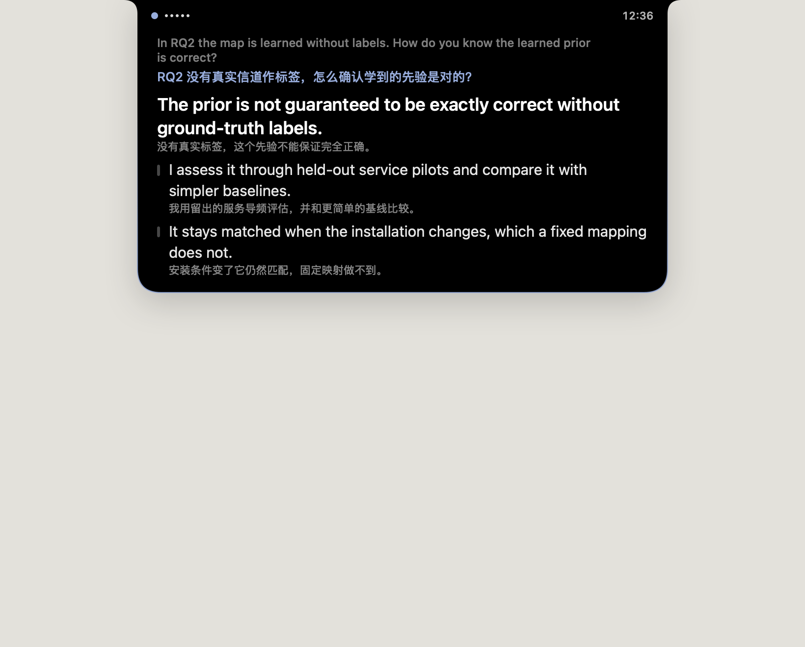

# NextThought v3.3.0

为英文答辩和面试做的一版：对着摄像头用英文讲和答，同时用中文看懂。v3.2.0 没有单独发布，它的改动（资料导入不再整份失败、讲稿跟随、纪要）也在这一版里，见 [v3.2.0 说明](v3.2.0.md)。

## 双语回答

- **回答语言**：齿轮面板和会中菜单的“回答语言”选 English，之后不管问题被识别成什么语言（英文里夹了几个中文词也一样），回答都用英文。选“跟随问题”时由程序数问题里的英文词和汉字来定，不再交给模型判断：英文提问一定用英文回答，点了几个英文术语的中文提问仍用中文回答。
- **英文回答附中文对照**（默认打开）：回答最上面用中文写清对方问的是什么，每句英文下面有这句话的中文意思。中文只帮你理解：提词岛判断“讲到哪一句”时只看英文，复制和纪要里的回答也只取英文。
- 回答写成 3 到 5 个短句，每句不超过 18 个词、只说一件事，用好念的词；数字取整着说（about ten percent），精确数值和页码留在中文对照里。
- 回答是要亲口说的话：句子里不再出现“资料里没有写”“无法确认”这类说法。资料里查不到的细节不说，在中文对照后面用括号提醒你补一句。

## 提问环节按整轮回答

讲完之后的提问环节，对方说的一整轮话就是问题，不再只盯着其中像问句的那一句。在“汇报 / 答辩”场景里，双屏演讲开着，或者你已经讲了一大段之后生效：

- **一轮里的几个问题一起答**：“我有两个问题，第一……第二……”会得到一份按顺序逐个回答的参考，第二个问题不再把第一个的回答顶掉。
- **质疑也会有回答**：对方用陈述句提出的怀疑（“我不太认同……”“我觉得这个基线太弱”）说完两秒后自动出回答：先认可合理的部分，再讲你的依据。
- 对方问完又补了几句，回答会按补充后的整轮话重写；你已经开口回答之后，对方“嗯”“好的”这样的应声不会让回答重来。
- 你抢在回答出来之前开口，回答立刻开始生成，不等对方的停顿。
- 提词岛上，新问题的两句话之间不再闪回上一个回答；回答生成的那两三秒里显示的是对方这一轮话的中文意思。

## 整份资料一起读

“汇报 / 答辩”场景里，放进来的资料加起来不超过 16 万字时（一份报告加一套幻灯片通常在这个范围内），每次回答都把全部原文交给模型，而不是只给查到的几个片段。用一份 24 页的报告和 39 页幻灯片实测：回答能直接说出数据集、频段、已有结果和论文计划，首字时间仍在 2 到 2.5 秒。

## 双屏演讲时不显示讲稿

用 PowerPoint 自带的演讲者备注时，在齿轮面板关掉“讲的时候显示这一页的讲稿”：讲的时候提词岛收在刘海里，被提问时才展开。当前在哪一页仍然会读取，回答里说“这一页”时用得上。

## 资料导入

- 一起拖进几份文件，文字 2 秒内全部可用，可以直接开始会议；语义索引在后面建。实测一份 28 页的报告 13 秒完成，41 页带图的幻灯片 73 秒完成，原来三份文件合计要 8 分半。
- 慢的原因是向量模型的显存缓存没有上限：每个片段长度不同，缓存越积越多，在 16 GB 的 Mac 上被挤到换页，一段向量从 0.05 秒拖到 1 秒以上。现在缓存有上限，速度不再随文件变长而下降。
- 读取和建索引不再共用一个名额：上一份文件在建索引时，下一份已经在读；一次读两份。
- 幻灯片自己的文字、表格和演讲备注先放进场景，图片随后再读，读完替换，已建好的向量继续用。
- SmartArt 的文字从图示数据里读出来，不再只给一条“请核对”。
- 只说明“这几页的图片没有读取”的文件算作已就绪，下面一行灰字写明是哪几页；读取失败、空白页这类才标“需核对”。同一条提示只出现一次。
- 整份资料交给回答模型时，同一页幻灯片或同一页论文的段落放在一个页码标记下。原来每个段落一个标记，页码是段落序号，标记本身占了五分之一的篇幅。

## 只有一个应用、一个主界面

- 电脑上有几份同名的 NextThought 时（构建产物、旧目录里的副本），它们用同一个标识和同一个数据目录。以前从 Spotlight 打开另一份，会多出一个同时运行、同时记录的应用。现在后启动的那份把已运行的带到前面，然后自己退出。
- 关闭过的主窗口还留在系统的窗口列表里，会议结束或从“隐藏”切回纪要窗口时曾把它一起显示出来，出现两个界面。现在只显示还开着的那个。
- 点 Dock 图标：已有主窗口（最小化、被挡住、在另一块屏上）就把它带到前面，没有才新建；多出来的重复窗口会被关掉。

## 同声传译上岛

- 对方说话时，提词岛显示听到的原文和中文译文（系统自带的本机翻译）。对方说完、回答出来后换成回答；你开口后回到讲稿。
- 同声传译记住上次的开关。没设置过时，听到对方说英文会自动开启，前提是翻译语言包已经装在这台 Mac 上，会议中不会弹出下载。
- 提词岛钉住一直展开时（⌘⇧E 或提词岛上的图钉），对方开始说新的一轮，原文和中文显示在回答上方，回答留在下面不让位；对照回答一次显示 5 句。
- 双屏演讲时主窗口是让开的，现在不用叫回主窗口也能看到译文。
- 屏幕上正显示着回答时，对方一两个词的插话不会把回答换走。

## 第一个问题不再多等

- 会议开始时和之后每 4 分钟，回答服务预热一次。一次排练里，开场后的第一个问题等了 13 秒，其中 10 秒花在回答服务闲置后的第一次建线程上，之后的问题是 2.4 到 3.4 秒。
- 整份资料已经读入时不再联网搜索：问的是你自己的工作，网上查不到，查回来的内容还会在几秒后改写已经写好的回答。英文的时效词按整词匹配，“I was wondering”不再被当成“won”。

## 说话人身份

- 给声音填名字时可以在括号里写身份，例如“Kai Wu（导师）”。整理纪要时模型按身份理解：导师、评委、客户说的是要求或意见，同学说的是建议。正文里只写名字。
- 纪要整理好之后再填名字也可以：纪要、导出和搜索里的“说话人 N”立即按名字显示，不用重新整理，原话引用不改。

## 术语

- 这个系列的资料里的专业词（缩写、带大小写变化的词、带数字的词）会自动取出来，作为语音识别的热词，并告诉回答、校对和纪要模型该怎么写。手填的术语表仍然优先。
- 每个场景新增“领域”一栏（例如“无线通信物理层”），回答、转写校对和纪要按这个领域理解专业词。

## 实测情况

- 用四种口音（澳大利亚、英国、印度、美国）合成的 7 段评委提问，在安装好的应用里走了一遍完整流程（系统声音、本机识别、整轮判定、真实回答服务、带着 15.6 万字的资料）：7 段都出了回答，一轮两个问题的那段两个都答了，陈述式质疑在说完 3.3 秒后出回答。首字时间第一题 13.4 秒（预热是为它加的），其余 2.4 到 3.4 秒，写完 3.6 到 7 秒。个别术语听错（near field 听成 neo field、MIMO 听成 memo），回答模型按上下文理解对了。合成语音比真人清楚，真人口音重、网络差时会更差。
- 三份真实资料（报告、幻灯片、讲稿）一起导入：文字 1.4 秒全部可用，报告 13 到 19 秒完成，幻灯片 73 到 92 秒完成。
- 在安装好的应用上验证过：重复打开应用、从另一份同名副本启动，都只有一个进程和一个主窗口。
- 没有实测的部分：回答语言自动判断、同声传译自动开启、预热和钉住时的新版式是排练之后改的，只通过了单元测试、离屏渲染和发布版自检；“关掉主窗口再打开后出现两个界面”的修复没有用真实点击复现过；会议软件里的真人通话整场没有跑过。
