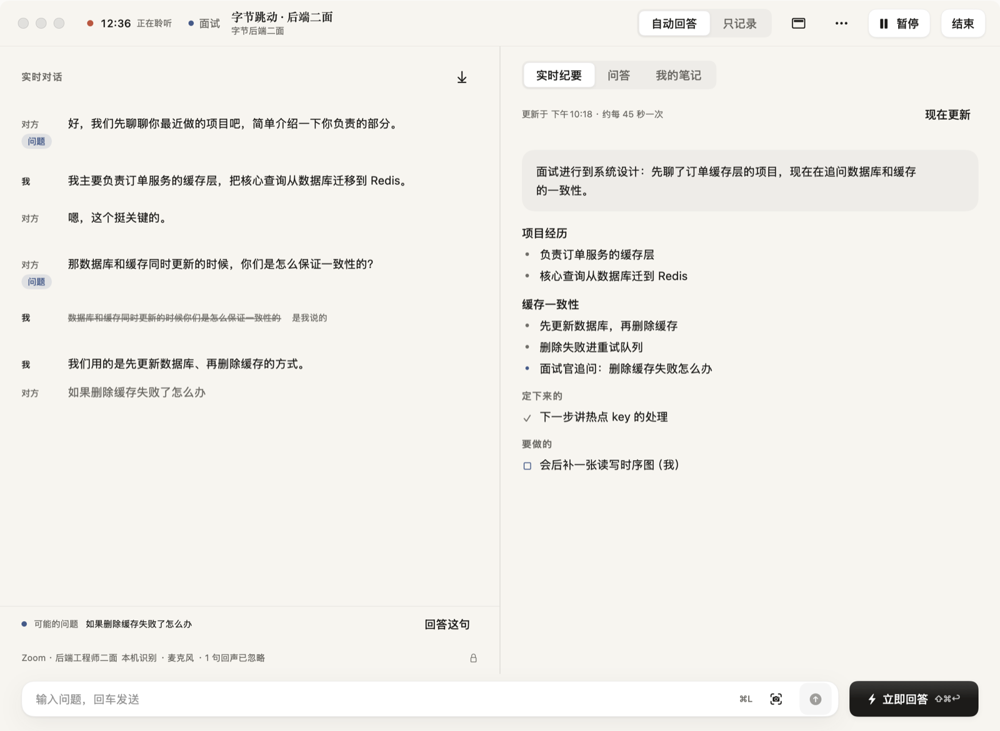
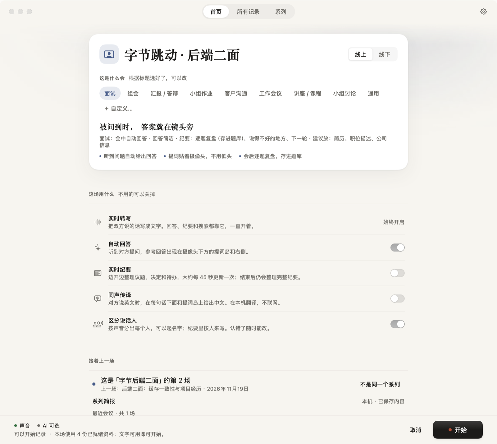

# NextThought v3.4.0

边开会边出纪要，开会前选好这场用什么，看得到自己用了多少。v3.3.1 没有单独发布，它修的转写丢字、会中窗口闪动和说话人修改也在这一版里。

## 实时纪要

- 会议进行中，右侧“实时纪要”大约每 45 秒更新一次：整场在谈什么、各个议题的要点、定下来的事、要做的事和负责人。上一次更新新增的内容用场景颜色标出。
- 较早的议题定稿后不再重写，所以开得再久，每次更新的量也不变。回复读不出来时保留原来的纪要，下一轮再试。
- 结束后仍然会从完整转写整理一份纪要；实时纪要是开会时扫一眼用的。
- 只记录的场景默认打开，自动回答的场景默认关闭（那时要读的是回答）。会中可以在“⋯”里开关，也可以点“现在更新”。
- 更新走你连接的回答服务，没有连接时不可用。
- 做法借鉴 [cicada](https://github.com/wquguru/cicada)（Apache-2.0）的 `Notes.swift`：带着当前纪要和新增内容请求一次，取回整份纪要。提示词和数据结构是 NextThought 自己的。

## 开会前选这场用什么

- 准备页标题下面列出五项，每项一句话说明是做什么的：实时转写（一直开着）、自动回答、实时纪要、同声传译、区分说话人。用不到的关掉再开始。
- 选择记在这个系列上，下一场沿用；“恢复这个场景的默认”一键还原。
- 同声传译打开时仍然是听到对方说英文才出现；关掉后这场不会自动开启。
- 从首页直接点“开始”不经过准备页，用的是这个系列上次的选择，没选过就用场景的默认值。

## 统计

- 首页“用了多少”：本月和累计的会议场数、记录时长、听到的提问、给出的回答。
- 每个系列的名字下面有一行同样的数字。
- 时长按每场从开始记录到结束计算，暂停的时间也算在内。回答次数包含被新回答替换掉的旧回答。

## 系列

- 顶部的“资料夹”改叫“系列”。一件要开很多场的事（一个项目的组会、一轮求职）是一个系列，资料、确认过的经验和常见问题留在系列里带到下一场。
- 首页“继续一个系列”每行显示开过几场、累计多久，点进去就是在这个系列里开下一场。
- 系列页的按钮从“新建记录”改为“开下一场”。

## 转写不再丢字，也不再卡住

- 远处或小声的讲话，实时识别听到了，但按音量分段的那一步不把它当成“说话”，一段话几分钟不收尾。等有人大声说一句才收尾时，只用最后几秒的重识别结果替换了整段，屏幕上显示过的内容就没了。一场线下报告里有一段 395 秒的讲话只留下了 61 个字。
- 现在重识别的结果只在覆盖了听到的全部内容时才替换。没人收尾的话，说话人停下 2.5 秒或连续说满 20 秒就成一句。
- 实时对话跟随到最后一行：新的一句有时停在上一句的位置，看起来像没更新。

## 会中窗口不再闪，第一下就能点到

- 双屏演讲时，显示器配置一变（投影仪重新握手、PowerPoint 开始放映切换镜像）就重新进入演讲模式并把主窗口藏起来，一场 12 分钟里发生了 20 次。现在等显示器稳定 1.5 秒再处理；你自己把主窗口叫回来之后，这场会里不再隐藏它。
- 主窗口在别的应用后面时，第一下点击只是把应用带到前面，按钮和菜单要点第二下。会议进行时第一下直接生效；“结束”和“暂停”不响应这一下，避免误触。
- 点击时不再重排窗口层级，刚点开的菜单不会被关掉。
- 关掉了系统的窗口标签页：“显示标签页栏”和 ⌘T 会在同一个窗口里再开一个界面。

## 说话人和转写可以改

- 线下会议没认出你的声音时，转写上方有“我是哪个？”，点一下从已有的人里选出来。
- 任何一句都可以右键“这句是谁说的”，改成我、某个人或“另一个人”，会中和会后都行。手动起名的人说得再少也会显示，已有的“说话人 N”编号不变。
- 会后右键“改这一句的文字”。原始转写不动，随时能在“原始转写”里看到；重新整理纪要时用改过的文字。

## 文字大小

- ⌘+ 和 ⌘− 放大、缩小全部页面的文字，⌘0 恢复，共 6 档。文字放大时左侧栏跟着加宽。
- 提词岛和回答浮窗仍用它们自己的大小按钮。

## 其他

- 应用在磁盘上的名字是 NextThought.app。

## 实测情况

- 实时纪要：一段编写的 24 句组会对话分三轮走了真实回答服务，每轮 7 到 10 秒，议题、决定和待办都取到了，三轮回复全部可用。有一条待办的负责人归错了人，之后调了提示词，没有再核对那一条。
- 转写丢字：用“远处小声五句 + 近处大声一句”的合成音频复现了问题，修复后六句都在。
- 文字缩放和“我是哪个？”面板在演示副本的真实窗口里操作过；统计数字和本机记录逐项对过。
- 没有实测的部分：实时纪要、开会前选功能、双屏演讲不再隐藏主窗口、第一下点击生效，都没有在真实会议里跑过；逐句改说话人和改文字的菜单没有用真实点击操作过。
